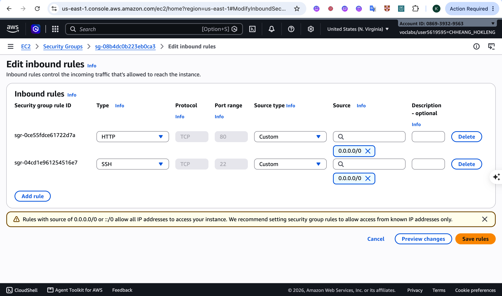
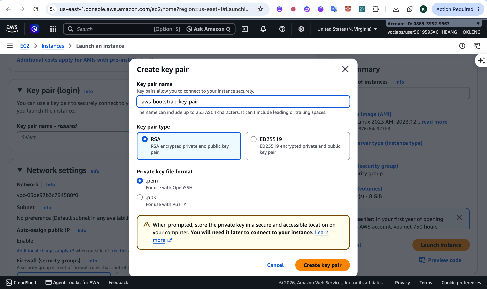
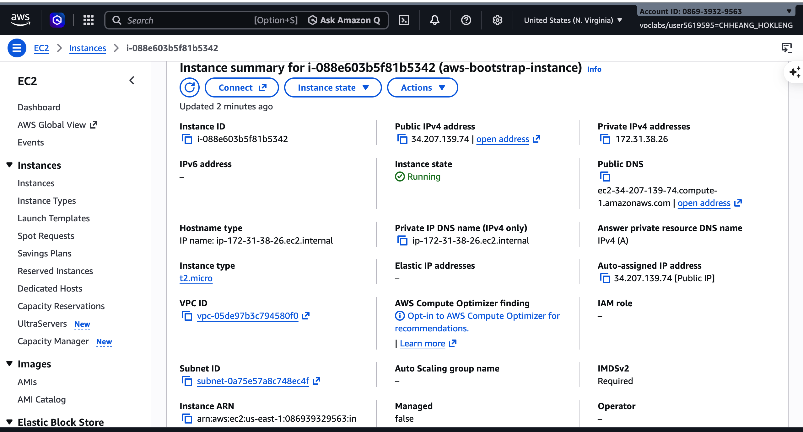
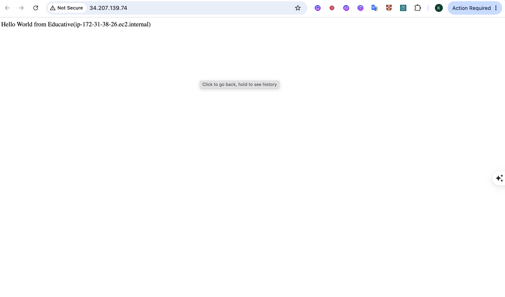
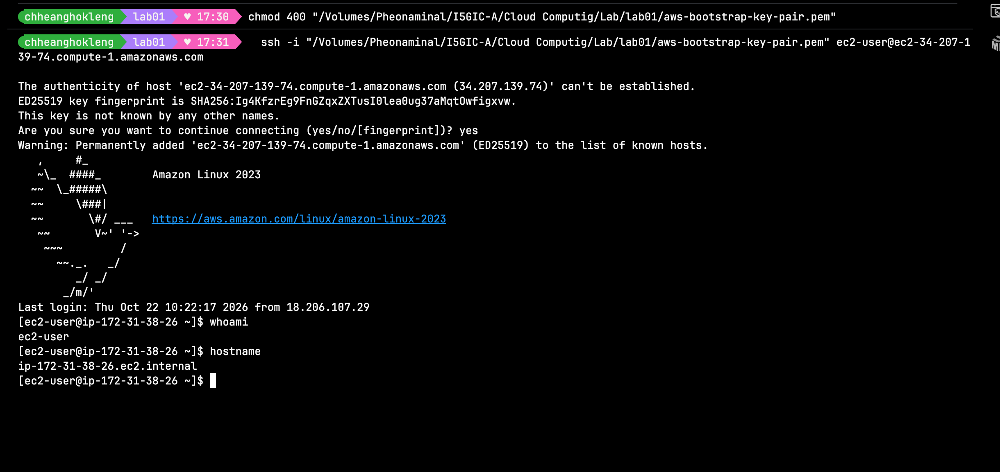
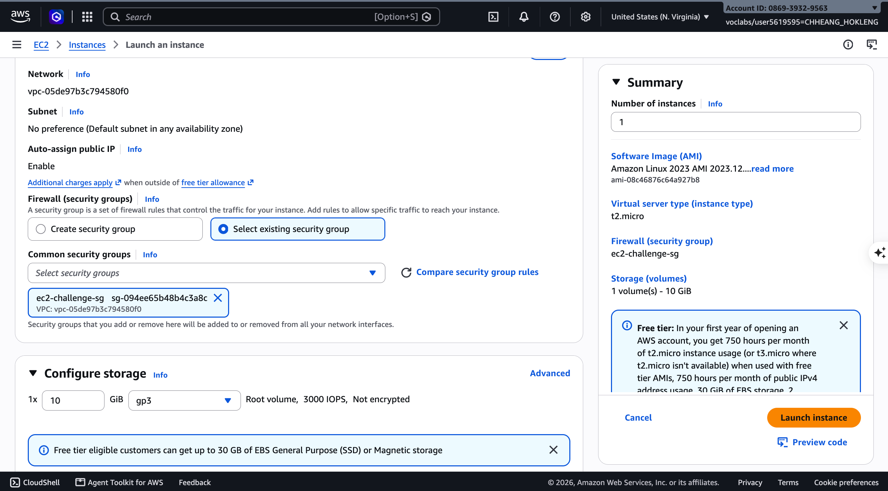
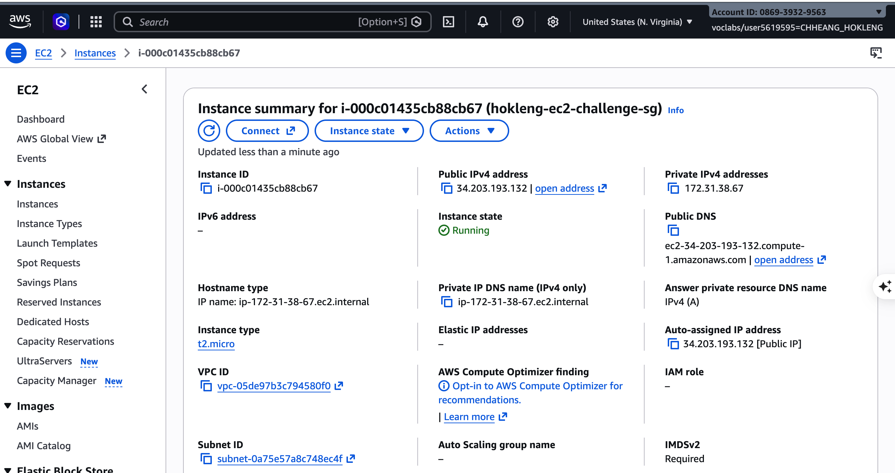
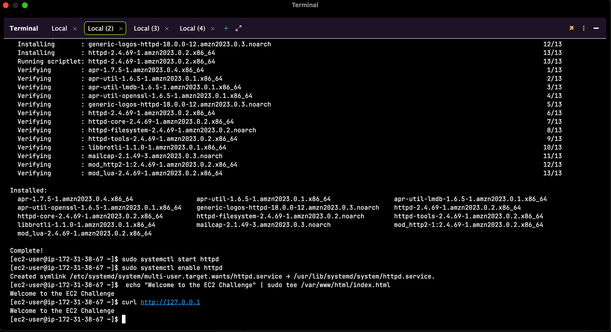
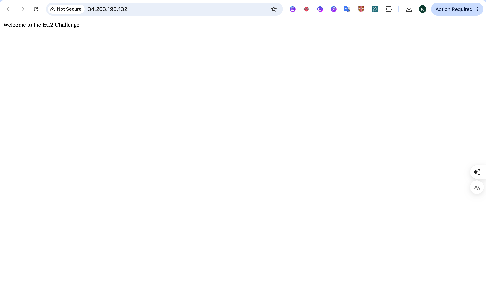

<div style="font-family: ui-sans-serif, system-ui, -apple-system, BlinkMacSystemFont, 'Segoe UI', Roboto, 'Helvetica Neue', Arial, sans-serif; font-size: 16px; line-height: 1.65; color: #1f2328; letter-spacing: 0.01em;">

<div align="center">

# Cloud Lab 1 Amazon EC2

**CHHEANG HOKLENG**

</div>

## Table of Contents

<table width="100%" cellpadding="0" cellspacing="0">
<tbody>
<tr><td style="white-space:nowrap;vertical-align:baseline;padding:3px 10px 3px 0;"><a href="#1-overview">1. Overview</a></td><td style="vertical-align:baseline;width:100%;"><div style="border-bottom:1px dotted #666;margin:0.75em 0 0 0;"></div></td></tr>
<tr><td style="white-space:nowrap;vertical-align:baseline;padding:3px 10px 3px 0;"><a href="#2-part-11-an-amazon-ec2-walkthrough">2. Part 1.1 An Amazon EC2 Walkthrough</a></td><td style="vertical-align:baseline;width:100%;"><div style="border-bottom:1px dotted #666;margin:0.75em 0 0 0;"></div></td></tr>
<tr><td style="white-space:nowrap;vertical-align:baseline;padding:3px 10px 3px 1.5em;"><a href="#21-resources">2.1 Resources</a></td><td style="vertical-align:baseline;width:100%;"><div style="border-bottom:1px dotted #666;margin:0.75em 0 0 0;"></div></td></tr>
<tr><td style="white-space:nowrap;vertical-align:baseline;padding:3px 10px 3px 1.5em;"><a href="#22-security-group-inbound-ssh-and-http">2.2 Security group (inbound SSH and HTTP)</a></td><td style="vertical-align:baseline;width:100%;"><div style="border-bottom:1px dotted #666;margin:0.75em 0 0 0;"></div></td></tr>
<tr><td style="white-space:nowrap;vertical-align:baseline;padding:3px 10px 3px 1.5em;"><a href="#23-key-pair">2.3 Key pair</a></td><td style="vertical-align:baseline;width:100%;"><div style="border-bottom:1px dotted #666;margin:0.75em 0 0 0;"></div></td></tr>
<tr><td style="white-space:nowrap;vertical-align:baseline;padding:3px 10px 3px 1.5em;"><a href="#24-instance-details">2.4 Instance details</a></td><td style="vertical-align:baseline;width:100%;"><div style="border-bottom:1px dotted #666;margin:0.75em 0 0 0;"></div></td></tr>
<tr><td style="white-space:nowrap;vertical-align:baseline;padding:3px 10px 3px 1.5em;"><a href="#25-browser-test">2.5 Browser test</a></td><td style="vertical-align:baseline;width:100%;"><div style="border-bottom:1px dotted #666;margin:0.75em 0 0 0;"></div></td></tr>
<tr><td style="white-space:nowrap;vertical-align:baseline;padding:3px 10px 3px 1.5em;"><a href="#26-ssh-connection">2.6 SSH connection</a></td><td style="vertical-align:baseline;width:100%;"><div style="border-bottom:1px dotted #666;margin:0.75em 0 0 0;"></div></td></tr>
<tr><td style="white-space:nowrap;vertical-align:baseline;padding:3px 10px 3px 1.5em;"><a href="#27-part-11-user-data-reference">2.7 Part 1.1 user data (reference)</a></td><td style="vertical-align:baseline;width:100%;"><div style="border-bottom:1px dotted #666;margin:0.75em 0 0 0;"></div></td></tr>
<tr><td style="white-space:nowrap;vertical-align:baseline;padding:3px 10px 3px 0;"><a href="#3-part-12-ec2-web-solution-challenge">3. Part 1.2 EC2 Web Solution (Challenge)</a></td><td style="vertical-align:baseline;width:100%;"><div style="border-bottom:1px dotted #666;margin:0.75em 0 0 0;"></div></td></tr>
<tr><td style="white-space:nowrap;vertical-align:baseline;padding:3px 10px 3px 1.5em;"><a href="#31-resources">3.1 Resources</a></td><td style="vertical-align:baseline;width:100%;"><div style="border-bottom:1px dotted #666;margin:0.75em 0 0 0;"></div></td></tr>
<tr><td style="white-space:nowrap;vertical-align:baseline;padding:3px 10px 3px 1.5em;"><a href="#32-launch-configuration">3.2 Launch configuration</a></td><td style="vertical-align:baseline;width:100%;"><div style="border-bottom:1px dotted #666;margin:0.75em 0 0 0;"></div></td></tr>
<tr><td style="white-space:nowrap;vertical-align:baseline;padding:3px 10px 3px 1.5em;"><a href="#33-security-group-inbound-ssh-and-http">3.3 Security group (inbound SSH and HTTP)</a></td><td style="vertical-align:baseline;width:100%;"><div style="border-bottom:1px dotted #666;margin:0.75em 0 0 0;"></div></td></tr>
<tr><td style="white-space:nowrap;vertical-align:baseline;padding:3px 10px 3px 1.5em;"><a href="#34-running-instance">3.4 Running instance</a></td><td style="vertical-align:baseline;width:100%;"><div style="border-bottom:1px dotted #666;margin:0.75em 0 0 0;"></div></td></tr>
<tr><td style="white-space:nowrap;vertical-align:baseline;padding:3px 10px 3px 1.5em;"><a href="#35-commands-on-the-instance">3.5 Commands on the instance</a></td><td style="vertical-align:baseline;width:100%;"><div style="border-bottom:1px dotted #666;margin:0.75em 0 0 0;"></div></td></tr>
<tr><td style="white-space:nowrap;vertical-align:baseline;padding:3px 10px 3px 1.5em;"><a href="#36-browser-test">3.6 Browser test</a></td><td style="vertical-align:baseline;width:100%;"><div style="border-bottom:1px dotted #666;margin:0.75em 0 0 0;"></div></td></tr>
<tr><td style="white-space:nowrap;vertical-align:baseline;padding:3px 10px 3px 0;"><a href="#4-problems-and-how-i-solved-them">4. Problems and how I solved them</a></td><td style="vertical-align:baseline;width:100%;"><div style="border-bottom:1px dotted #666;margin:0.75em 0 0 0;"></div></td></tr>
</tbody>
</table>

---

## 1. Overview

This report documents **Cloud Lab 1** (Amazon EC2 walkthrough and challenge) completed in **AWS Academy Learner Lab**, region **US East (N. Virginia) `us-east-1`**.

---

## 2. Part 1.1 An Amazon EC2 Walkthrough

### 2.1 Resources

| Resource | Name / value |
|:---------|:-------------|
| Security group | `aws-bootstrap-security-group` |
| Key pair | `aws-bootstrap-key-pair` |
| Instance | `aws-bootstrap-instance` (`t2.micro`, Amazon Linux 2023) |
| Public IPv4 | `34.207.139.74` |

### 2.2 Security group (inbound SSH and HTTP)

<p align="center">
  
  <br/>
  <em>Figure 2.2 Inbound rules for aws-bootstrap-security-group</em>
</p>

### 2.3 Key pair

<p align="center">
  
  <br/>
  <em>Figure 2.3 Create key pair aws-bootstrap-key-pair</em>
</p>

### 2.4 Instance details

<p align="center">
  
  <br/>
  <em>Figure 2.4 aws-bootstrap-instance running</em>
</p>

### 2.5 Browser test

Opened `http://34.207.139.74/` (HTTP, not HTTPS).

<p align="center">
  
  <br/>
  <em>Figure 2.5 Hello World from Educative in browser</em>
</p>

### 2.6 SSH connection

Connected with the **SSH client on my Mac** using the `.pem` key (not EC2 Instance Connect for this screenshot).

```bash
chmod 400 aws-bootstrap-key-pair.pem
ssh -i aws-bootstrap-key-pair.pem ec2-user@ec2-34-207-139-74.compute-1.amazonaws.com
whoami
hostname
```

<p align="center">
  
  <br/>
  <em>Figure 2.6 SSH session with whoami and hostname</em>
</p>

I also used **EC2 Instance Connect** once to fix `index.html` when the default Apache page appeared.

### 2.7 Part 1.1 user data (reference)

```bash
#!/bin/bash
sudo su
yum update -y
yum install -y httpd.x86_64
systemctl start httpd.service
systemctl enable httpd.service
echo "Hello World from Educative($(hostname))" > /var/www/html/index.html
```

---

## 3. Part 1.2 EC2 Web Solution (Challenge)

### 3.1 Resources

| Resource | Name / value |
|:---------|:-------------|
| Security group | `ec2-challenge-sg` |
| Key pair | `ec2-challenge-key-pair` |
| Instance | `hokleng-ec2-challenge-sg` (`t2.micro`, Amazon Linux 2023, 10 GiB root volume) |
| Public IPv4 | `34.203.193.132` |

### 3.2 Launch configuration

<p align="center">
  
  <br/>
  <em>Figure 3.2 Challenge launch, Amazon Linux 2023 and network settings</em>
</p>

### 3.3 Security group (inbound SSH and HTTP)

`ec2-challenge-sg` was configured with the same inbound pattern as Part 1.1: **SSH (22)** and **HTTP (80)** from **0.0.0.0/0**. Outbound traffic was set to **All traffic** so `dnf` could reach package repositories over HTTPS.

<p align="center">
  
  <br/>
  <em>Figure 3.3 Inbound SSH and HTTP rules</em>
</p>

If your instructor requires the security group **name** visible in screenshot `07`, replace this file with an inbound-rules capture of `ec2-challenge-sg` from the console. The original is kept under `images/_originals/`.

### 3.4 Running instance

<p align="center">
  
  <br/>
  <em>Figure 3.4 Challenge instance running with public IP</em>
</p>

### 3.5 Commands on the instance

```bash
sudo dnf install -y httpd
sudo systemctl start httpd
sudo systemctl enable httpd
echo "Welcome to the EC2 Challenge" | sudo tee /var/www/html/index.html
curl http://127.0.0.1
```

<p align="center">
  
  <br/>
  <em>Figure 3.5 Install httpd and test with curl</em>
</p>

### 3.6 Browser test

Opened `http://34.203.193.132/`.

<p align="center">
  
  <br/>
  <em>Figure 3.6 Welcome to the EC2 Challenge in browser</em>
</p>

---

## 4. Problems and how I solved them

- **Browser timeout / `dnf` failures**: Inbound rules were missing or HTTP/SSH were added to **outbound** only. Fixed by adding **inbound** SSH + HTTP and **outbound All traffic** (so HTTPS to repos works for `dnf`).
- **"Waiting for process with pid …"**: Only one `dnf` session at a time; cleared stale lock with `sudo rm -f /var/run/dnf.pid` when needed.
- **Browser loading forever**: Used `http://` explicitly (not `https://`) and the current public IP from the console.

</div>
