# Cloud Lab 10 Submission — Infrastructure as Code

- **Student name:** CHHEANG HOKLENG
- **Student ID:** e20220695
- **Learner Lab user name:** voclabs/user5619595=CHHEANG_HOKLENG
- **Where I ran Terraform:** macOS (Apple Silicon), Terraform **v1.15.2**, AWS provider **~> 4.67**
- **Date completed:** November 11, 2026

---

## Part 10.1 — AWS CloudFormation

### Stack created

CloudFormation stack **`cf-lab-stack`** after the initial template: EC2 instance and security group resources.

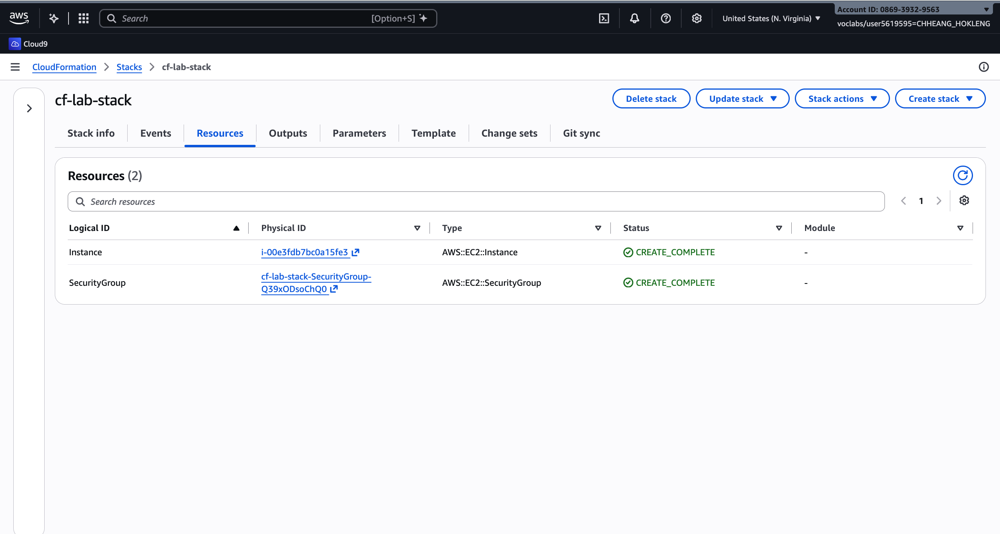

**Outputs** tab showing **`InstanceEndpoint`** for the first web server.

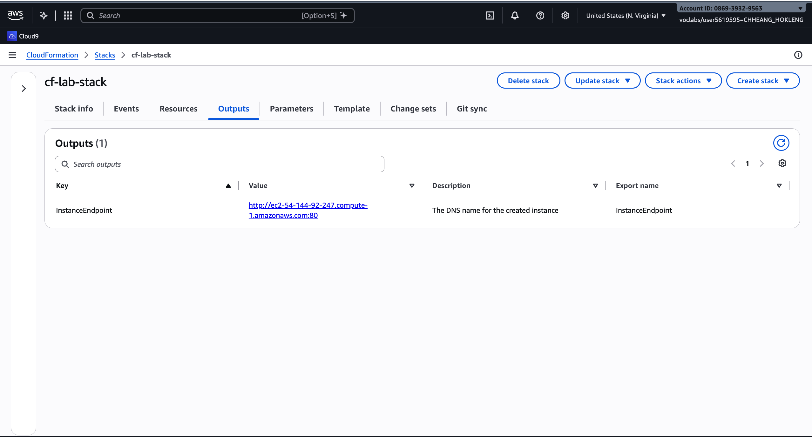

First instance in the browser: *Hello World from Educative*.

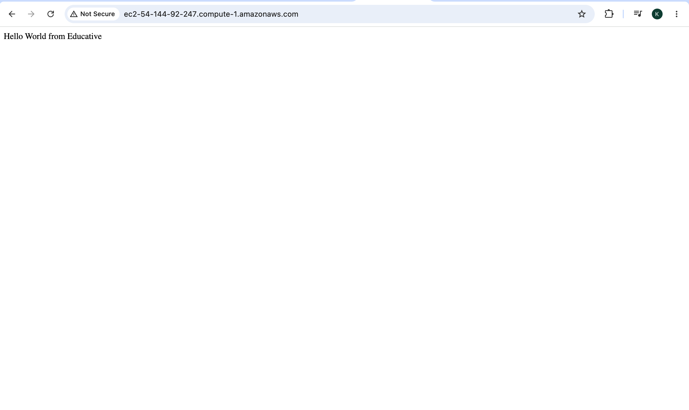

### Stack updated

**Resources** after updating the stack: **`SecondInstance`** and **`SecondSecurityGroup`** added.

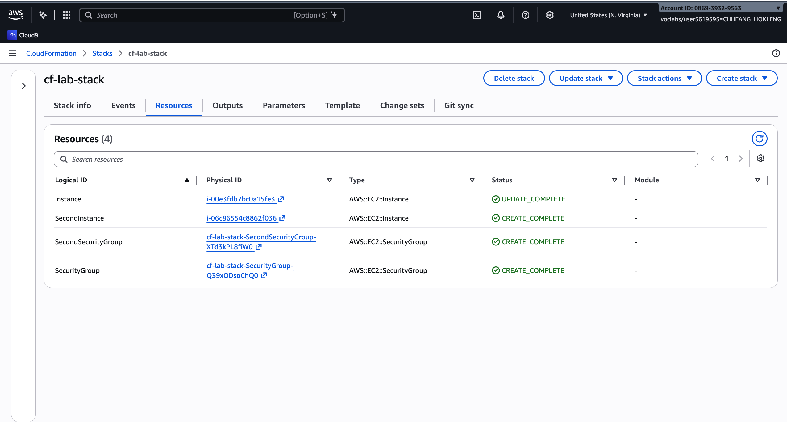

**Outputs** with **`InstanceEndpoint`** and **`SecondInstanceEndpoint`**.

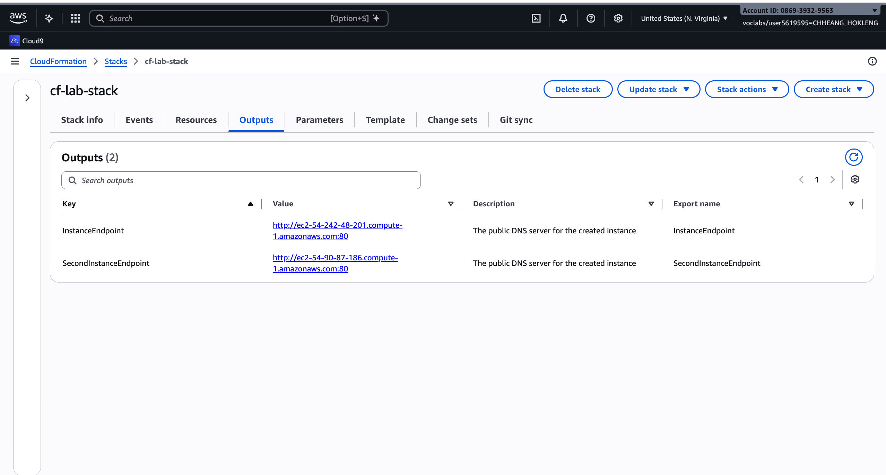

Second instance in the browser: *Hello World from Second Instance*.

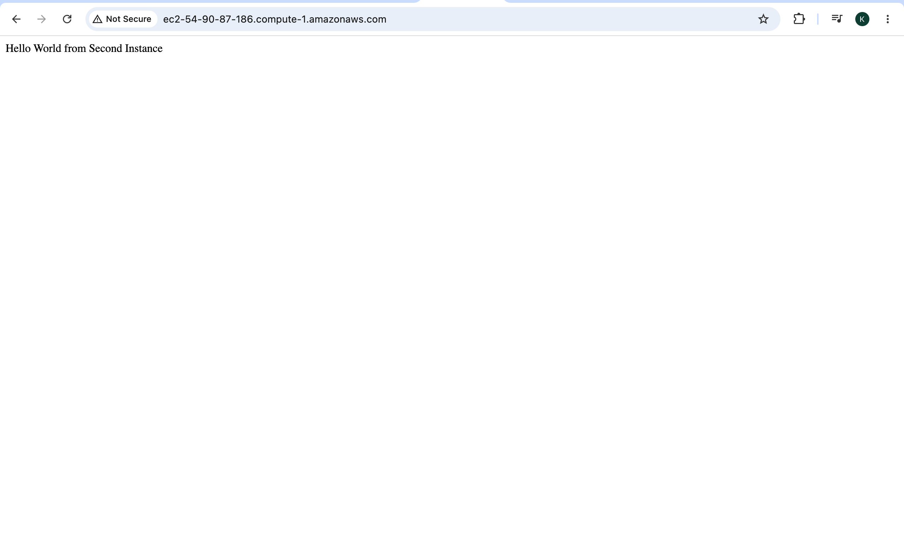

Templates: [original](cloudformation/CloudFormation_Lab_Template.yaml) · [updated](cloudformation/CloudFormation_Lab_Updated_Template.yaml)

---

## Part 10.2 — Terraform

### S3 bucket, object and policy

Terraform **`apply`** for S3 bucket settings (`my-bucket-e20220695`); infrastructure matches configuration.

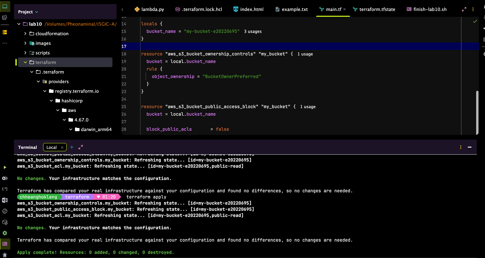

**`apply`** creating **`aws_s3_object`** — **`index.html`** uploaded to the bucket.

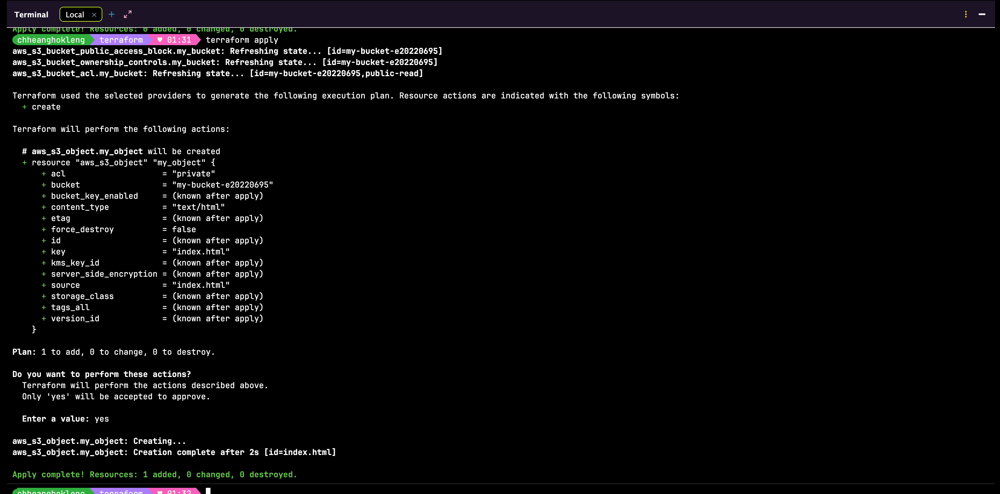

**`aws s3 ls s3://my-bucket-e20220695`** lists **`index.html`**.

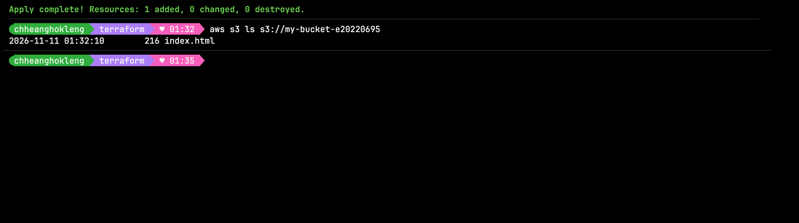

Bucket policy allowing public **`s3:GetObject`** (Terraform plan/apply for **`aws_s3_bucket_policy`**).

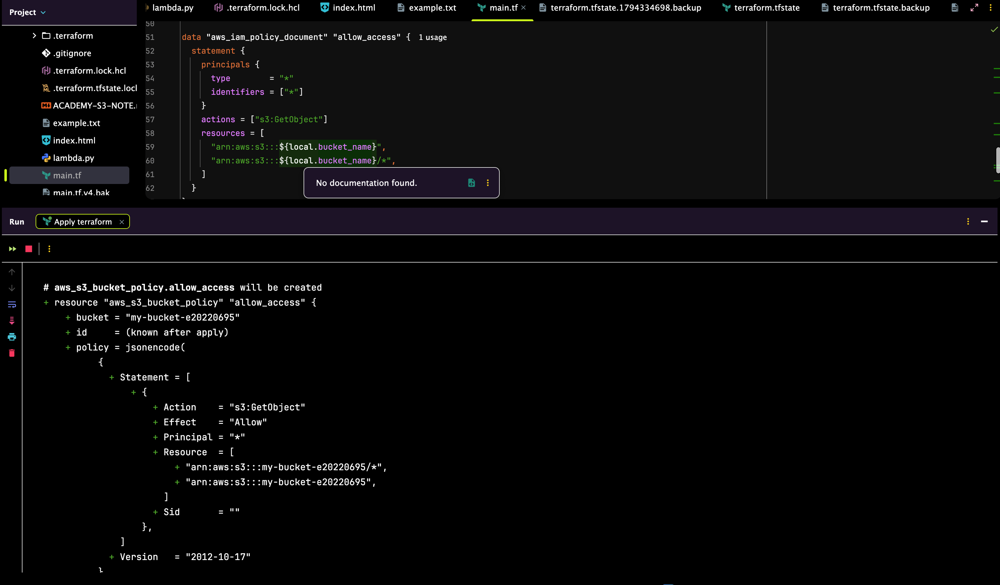

### Lambda function and function URL

**`apply`** (replace) creating **`LambdaFunction`** — runtime **python3.10**, handler reads **`index.html`** from S3.

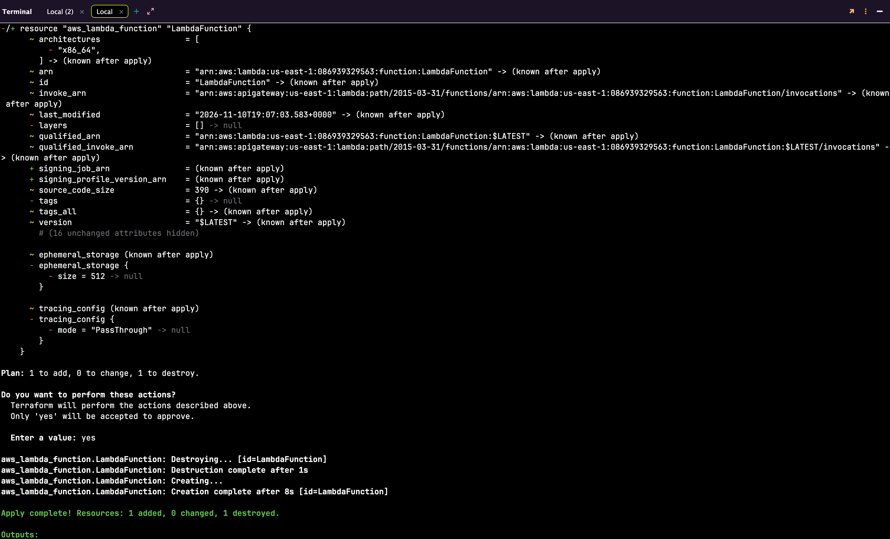

Terminal **Outputs:** **`function_url`** for the Lambda function URL.

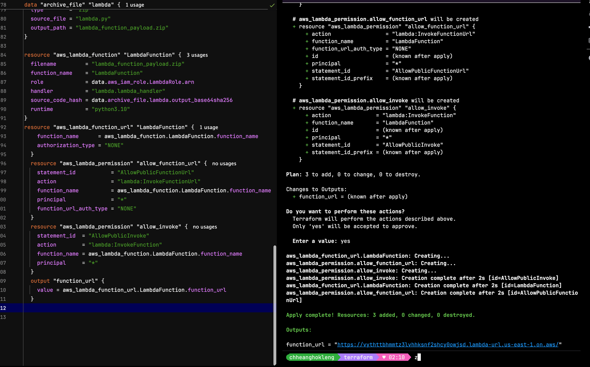

Function URL in the browser: sample website HTML from the bucket.

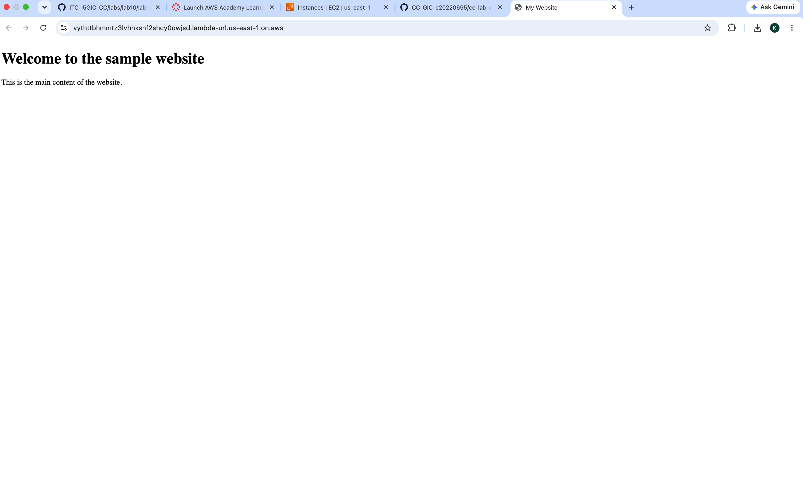

### EC2 instance

Security group **`allow-port-3000`**: inbound **TCP 3000** from **0.0.0.0/0**.

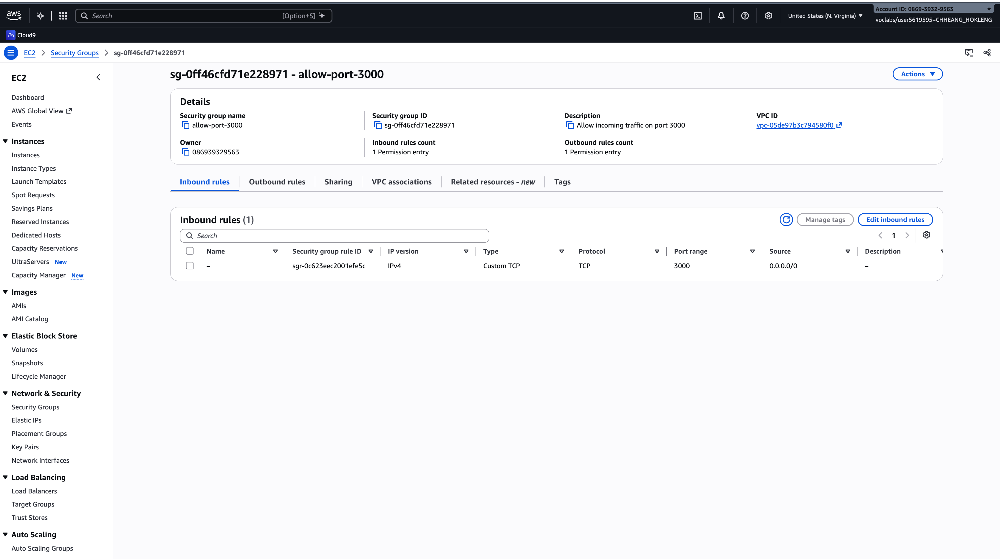

**`apply`** outputs **`public_ip`** for instance **`clab-app`**.

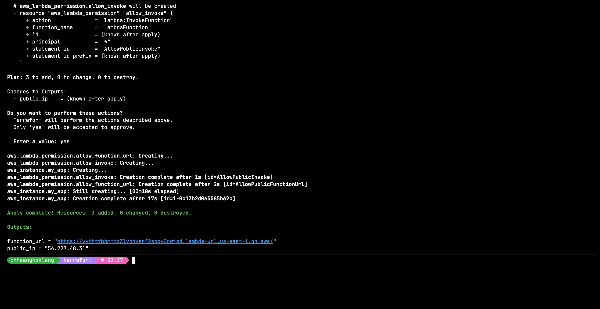

React app at **`http://<public_ip>:3000`** (*Your app is Live!*).

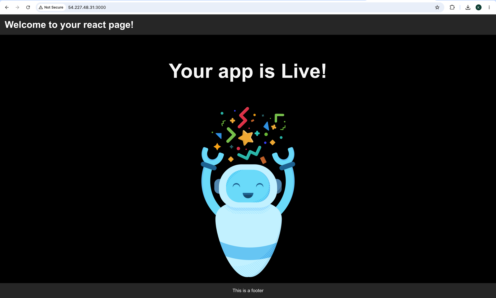

My Terraform code: [main.tf](terraform/main.tf) · [lambda.py](terraform/lambda.py) · [index.html](terraform/index.html)

---

## Questions

### 1. In the CloudFormation **Changeset preview** of the update, which resources were added, and was the first instance changed or replaced?

**Added:** **`SecondSecurityGroup`** and **`SecondInstance`**. The first instance was **changed in place** (updated), not replaced — the changeset shows **Modify** on **`Instance`** (user data / content), not **Replace** on the first EC2 resource.

### 2. To remove everything in Part 10.1 you deleted one stack. What is the advantage compared with deleting each resource in the console?

Deleting **one stack** removes **all** stack resources in the right order with **one action**. You avoid missing dependencies, wrong delete order, and leaving orphaned security groups or instances.

### 3. Why did you run `terraform init` again before creating the Lambda function?

**`init`** installs new **provider plugins** (e.g. **`hashicorp/archive`** for the zip) and refreshes the backend after **`main.tf`** starts using new provider/resource types. Without **`init`**, Terraform cannot load **`archive_file`** or new AWS resources.

### 4. What is stored in `terraform.tfstate`, and why must it **not** be committed to Git?

**`terraform.tfstate`** maps Terraform resource names to **real AWS IDs** (bucket name, Lambda ARN, instance ID, etc.). It must **not** be committed because it is **environment-specific**, may expose sensitive attributes, and causes conflicts if two people commit different state. State belongs local or in a remote backend, not the course repo.

### 5. The `aws_s3_bucket_acl` block has a `depends_on`. What would go wrong without it?

**`aws_s3_bucket_ownership_controls`** and **`aws_s3_bucket_public_access_block`** must exist before the ACL can be set. Without **`depends_on`**, Terraform might apply the ACL **first** and fail with errors about ownership or public access blocks still blocking ACL changes.

### 6. Compare CloudFormation and Terraform: name one thing they have in common and one difference you noticed in this lab.

**In common:** Both use **declarative IaC** — you describe desired infrastructure in files and the tool creates/updates AWS resources. **Difference:** CloudFormation is **AWS-only** and stack-based (**create/update/delete stack**); Terraform is **multi-provider**, uses **`plan` / `apply` / `destroy`** on your laptop, and keeps state in **`terraform.tfstate`**.

## Problems and how I solved them (optional)

- **S3 / Object Lock 403 in Learner Lab:** Provider tried **`GetBucketObjectLockConfiguration`**; used provider **4.67** and bucket name by **`locals`** after the bucket was created.
- **Lambda `python3.11` rejected:** Provider **4.67** validation list; used **`python3.10`** instead.
- **Terraform state lock:** Stale **`.terraform.tfstate.lock.info`** after interrupted **`apply`** — removed lock file when no **`terraform`** process was running.

## Clean up

- [ ] Stack `cf-lab-stack` deleted.
- [ ] `terraform destroy` finished with *Destroy complete*.
