# Lab 2 — Application Load Balancer and Auto Scaling Group

**Course:** ITC-I5GIC-CC (Cloud Computing)  
**Region:** `us-east-1` (US East N. Virginia)  

- **Student name:** CHHEANG HOKLENG  
- **Student ID:** e20220695  
- **Learner Lab user name:** CHHEANG_HOKLENG  
- **Date completed:** 05 November 2026  

## What this lab demonstrates

An **Application Load Balancer** forwards HTTP traffic to a **target group** of EC2 instances. An **Auto Scaling group** keeps **two** instances registered and replaces instances that fail **Elastic Load Balancing health checks**.

---

## Screenshots

### 01 — `01-sg-load-balancer.png`

**LoadBalancerSecurityGroup** inbound **HTTP (80)** from **Anywhere-IPv4** on the default VPC.

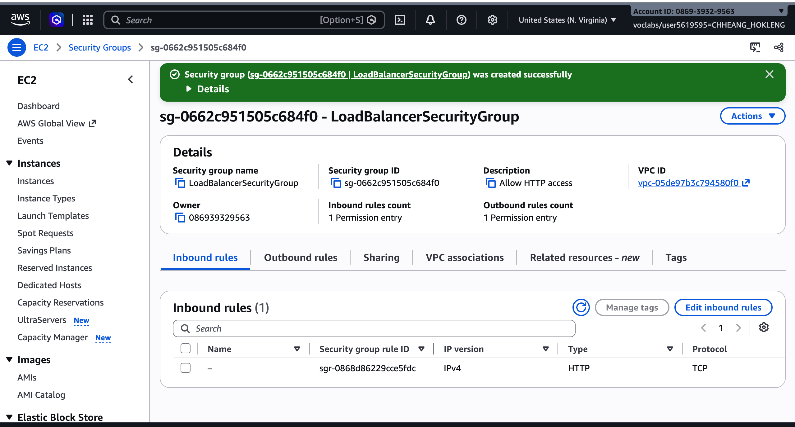

### 02 — `02-sg-launch-template.png`

**LaunchTemplateSecurityGroup**: **HTTP (80)** and **SSH (22)** from **Anywhere-IPv4** (create form; optional retake on **Inbound rules** details page).

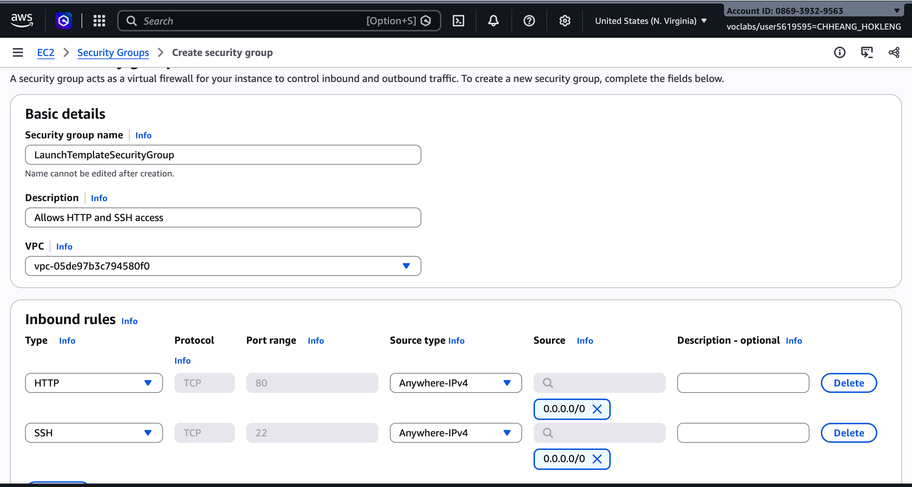

### 03 — `03-target-group.png`

**LoadBalancerTargetGroup**: **HTTP**, port **80**, default VPC.

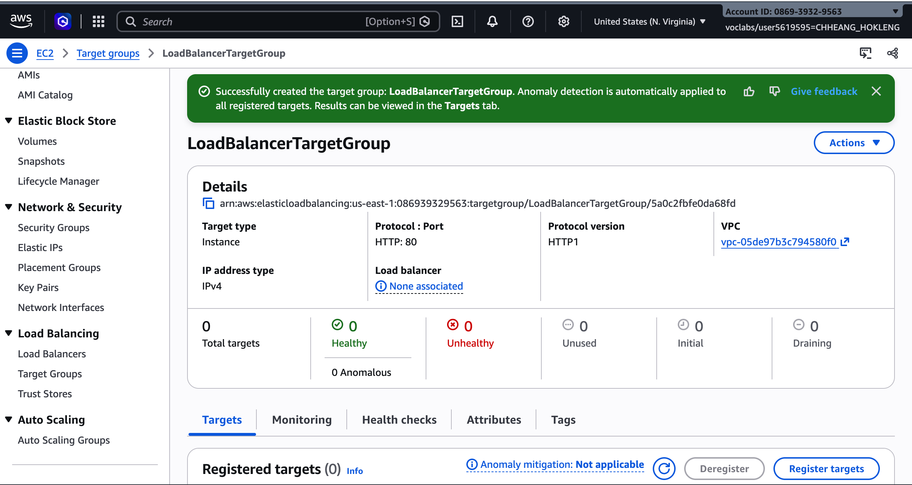

### 04 — `04-health-checks.png`

**Health checks** tab: **HTTP**, path **`/`**, interval **30 s**, success code **200**.

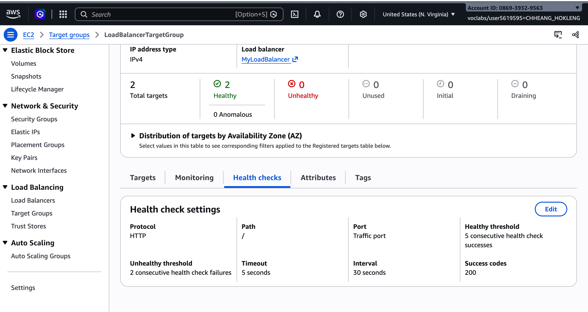

### 05 — `05-load-balancer-list.png`

**Load balancers** list: **MyLoadBalancer**, state **Active**.

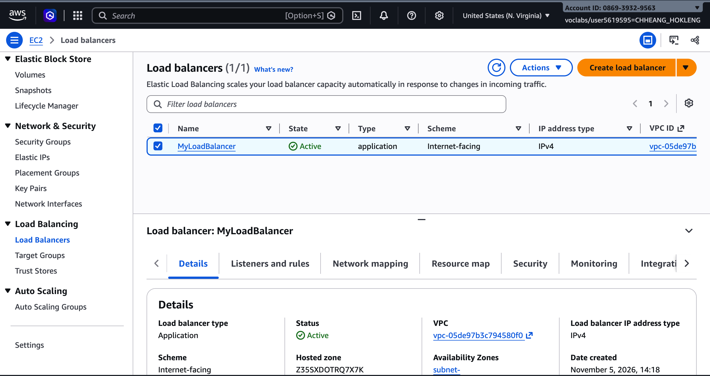

### 06 — `06-load-balancer-details.png`

**MyLoadBalancer** details: **Internet-facing**, application LB, DNS name.

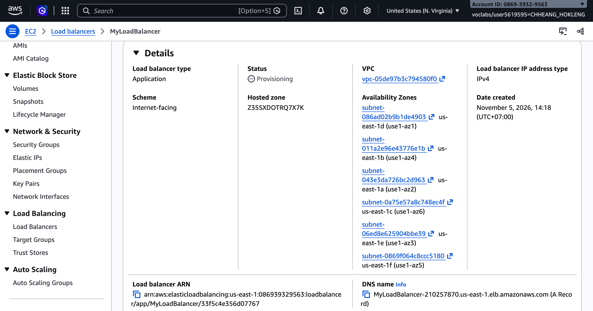

### 07 — `07-launch-template.png`

**AutoScalingLaunchTemplate**: Amazon Linux 2023 AMI, **t2.micro**, **LaunchTemplateSecurityGroup** (optional retake with **User data** visible).

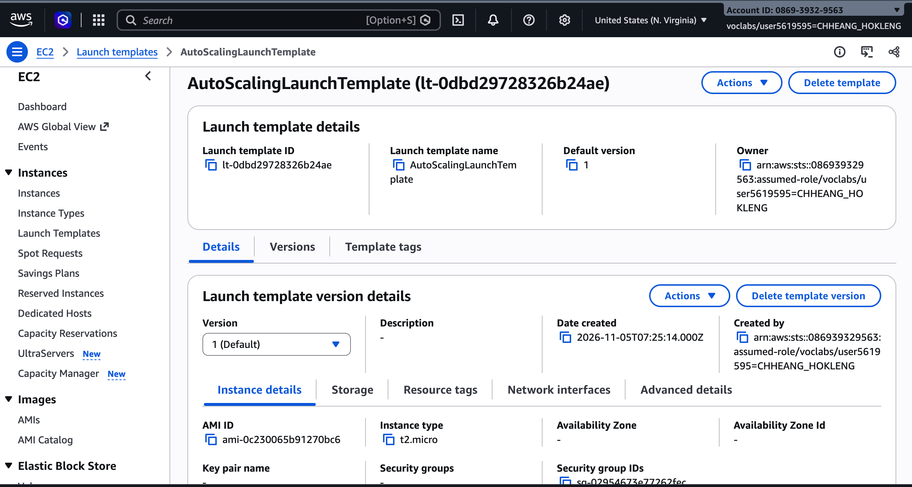

### 08 — `08-asg-list.png`

**Auto Scaling groups** list: **MyAutoScalingGroup**, **2/2** healthy, min **2** / max **3**.

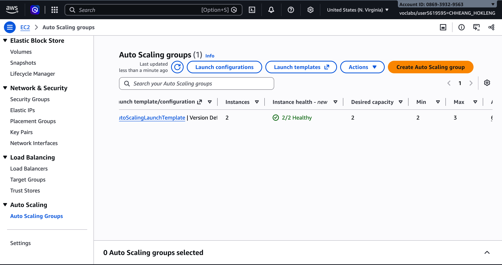

### 09 — `09-asg-details.png`

**MyAutoScalingGroup** details: desired **2**, limits **2–3**, launch template **AutoScalingLaunchTemplate**.

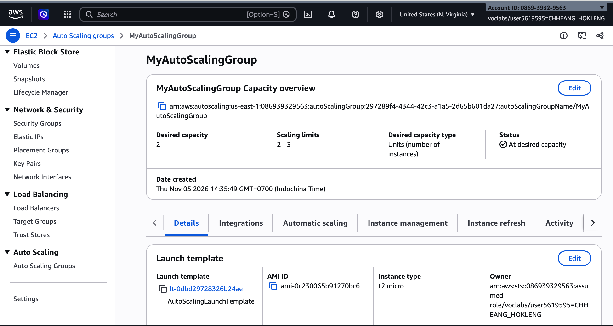

### 10 — `10-browser-1.png`

Load balancer URL: **Hello World** from first backend hostname.

### 11 — `11-browser-2.png`

Same URL after refresh: **different** hostname (load balancing).

### 12 — `12-stop-httpd.png`

**EC2 Instance Connect** after `sudo systemctl stop httpd.service`.

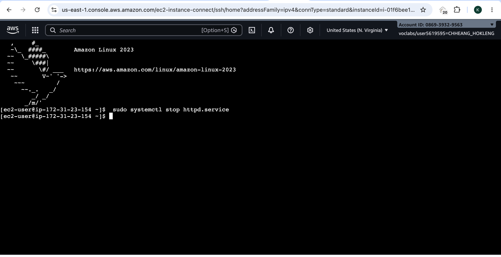

### 13 — `13-target-unhealthy.png`

**Targets**: one instance **Draining**, one **Healthy**.

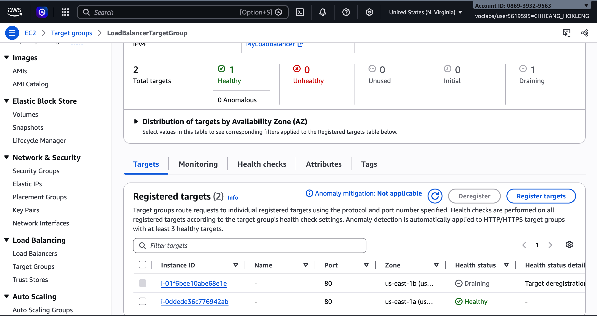

### 14 — `14-target-replaced.png`

**Targets** after ASG replacement: **two** registered targets **Healthy**.

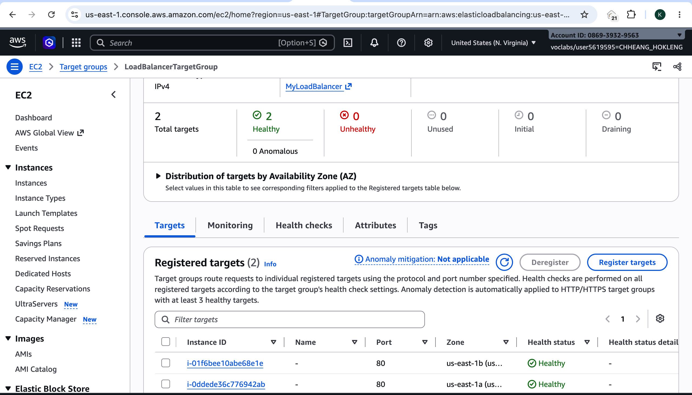

---

## Resources created (lab names)

| Resource | Name |
|----------|------|
| Security group (ALB) | `LoadBalancerSecurityGroup` |
| Security group (instances) | `LaunchTemplateSecurityGroup` |
| Target group | `LoadBalancerTargetGroup` |
| Load balancer | `MyLoadBalancer` |
| Launch template | `AutoScalingLaunchTemplate` |
| Auto Scaling group | `MyAutoScalingGroup` |

---

## Conclusion

This lab showed how an Application Load Balancer gives clients one DNS name while traffic is spread across several EC2 instances.  
Security groups separate the load balancer from the application tier and allow HTTP health checks and user access on the instances.  
The target group and its health checks on path `/` decide which instances receive traffic and which are removed from rotation.  
A launch template and Auto Scaling group automate instance launches and keep desired capacity linked to the target group.  
Browser tests confirmed load balancing when the hostname in the Hello World page changed between refreshes.  
Stopping `httpd` on one instance triggered failed health checks, deregistration, and replacement by a new healthy instance.  
Together, these pieces illustrate resilient, scalable web serving on AWS using ELB and Auto Scaling in `us-east-1`.

---

## Clean up (after screenshots)

Delete in order: Auto Scaling group → launch template → load balancer → target group → both security groups.
