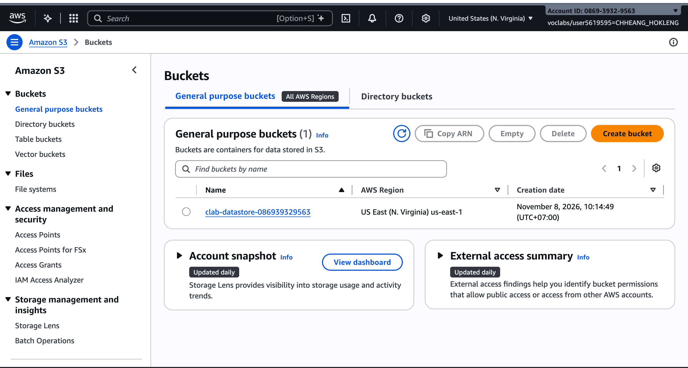
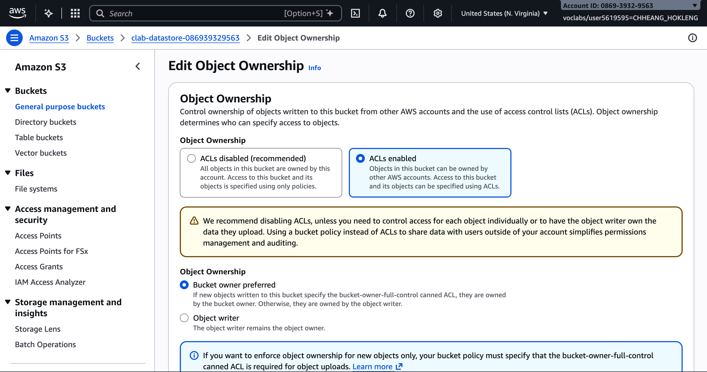
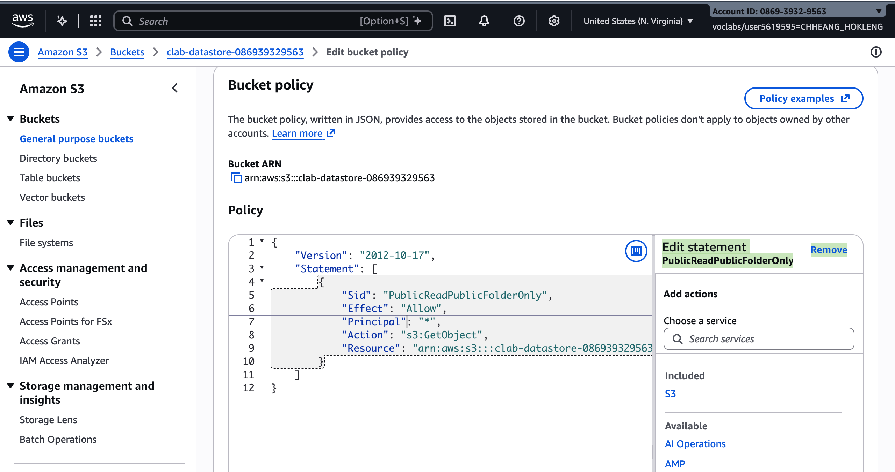
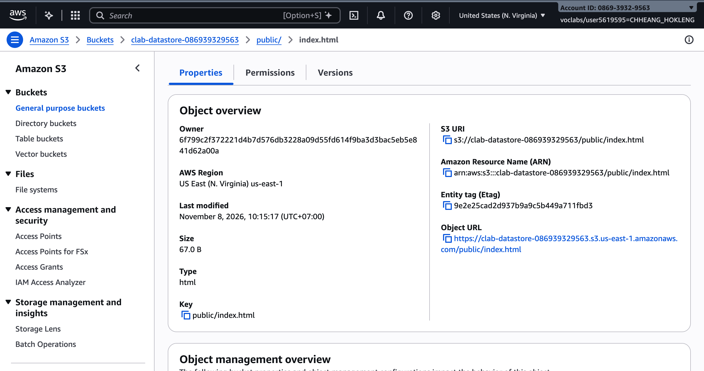
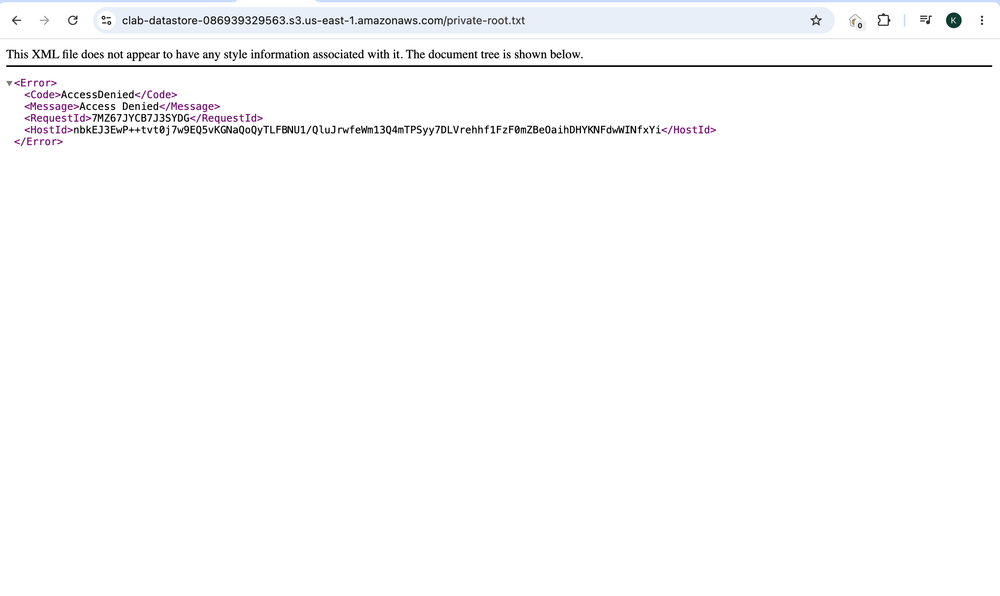
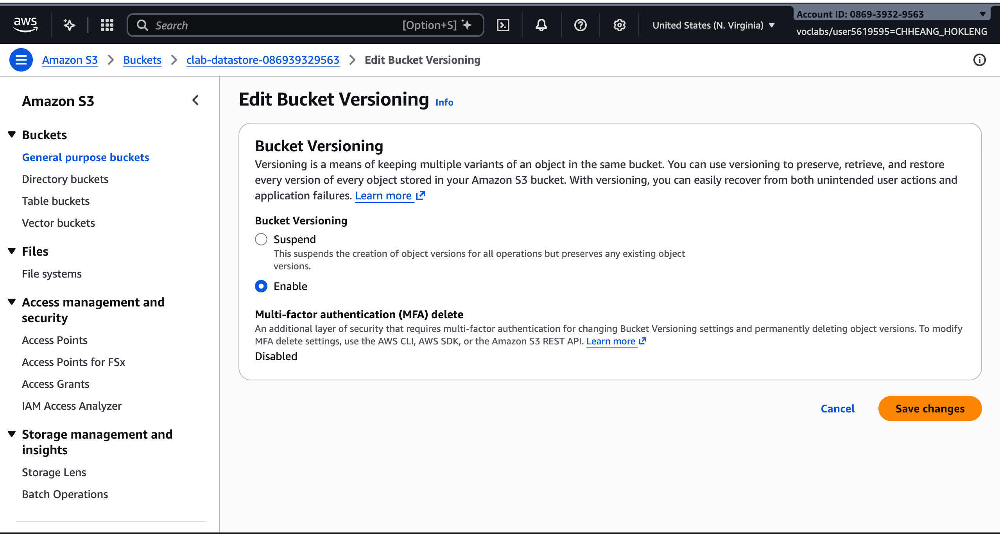
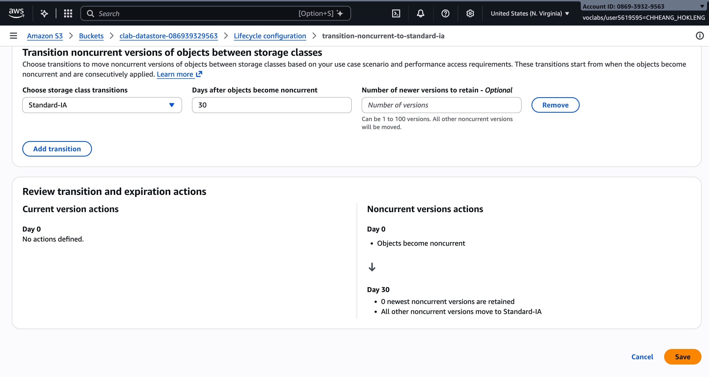

# Cloud Lab 3 Challenge Submission — Secure S3 Bucket

- **Student name:** CHHEANG HOKLENG
- **Student ID:** e20220695
- **Learner Lab user name:** CHHEANG_HOKLENG
- **Bucket name:** `clab-datastore-086939329563`
- **Date completed:** 2026-11-08

---

## 1. Bucket

## 2. Object ownership

## 3. Public access policy

Object URL opens in the browser as **Public offers v2** (current version of `public/index.html`).

My policy is in [bucket-policy.json](bucket-policy.json).

**Which line limits public access to `public/`?** The `"Resource"` value `arn:aws:s3:::clab-datastore-086939329563/public/*` — only object keys under the `public/` prefix match; root objects and other folders are not included.

**Test URLs used:**

- Public: `https://clab-datastore-086939329563.s3.amazonaws.com/public/index.html` (HTTP 200)
- Private: `https://clab-datastore-086939329563.s3.amazonaws.com/private-root.txt` (AccessDenied)

## 4. Versioning

## 5. Lifecycle rule

Rule ID: `transition-noncurrent-to-standard-ia` — applies to all objects; noncurrent versions → **S3 Standard-IA** after **30** days.

---

## Questions

1. You turned off parts of **Block Public Access** for this bucket. Why was that needed, and why is it still safe for the objects outside `public/`?
   - **BlockPublicPolicy** (and **RestrictPublicBuckets**) had to allow a bucket policy that grants public `s3:GetObject`. **BlockPublicAcls** and **IgnorePublicAcls** stay on, so ACLs cannot open the whole bucket. The policy only allows `public/*`, so objects outside `public/` remain private.

2. What is a **noncurrent version**? Give an example from your own test.
   - After versioning is on, uploading a new version of the same key leaves the previous version as a **noncurrent** version. Example: upload `public/index.html` twice; the first version becomes noncurrent when the second upload completes.

3. Why move noncurrent versions to S3 Standard-IA instead of deleting them?
   - The team wants history for rollback/audit but does not need frequent access to old copies. Standard-IA is cheaper than Standard for infrequently read data, while still keeping those versions.

## Clean up

- [x] All object versions deleted and the bucket deleted (2026-11-08).
