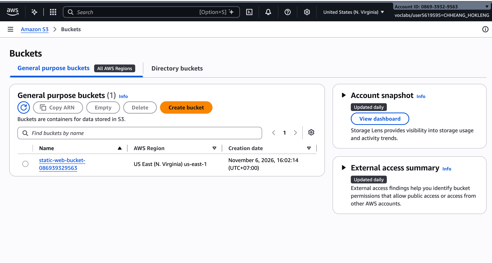
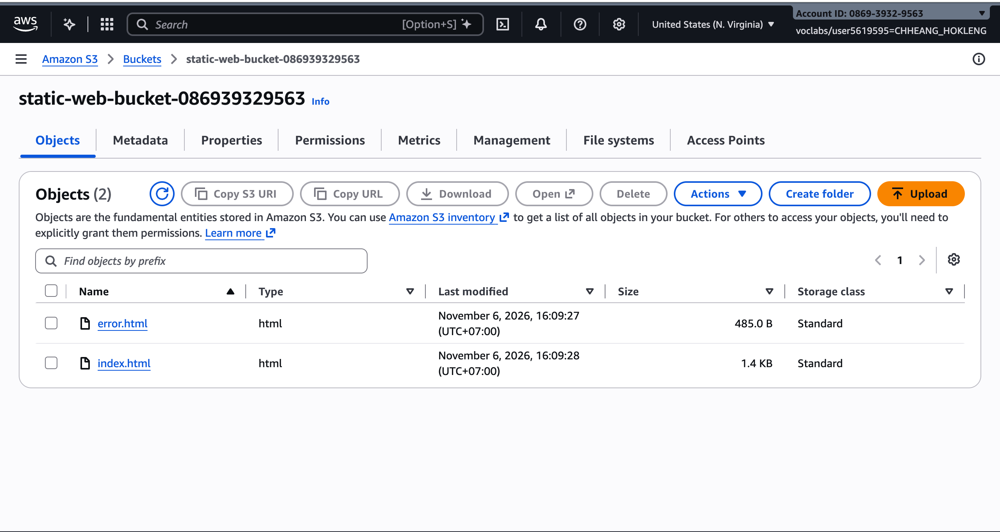
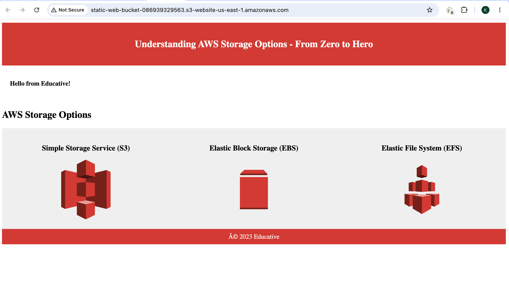
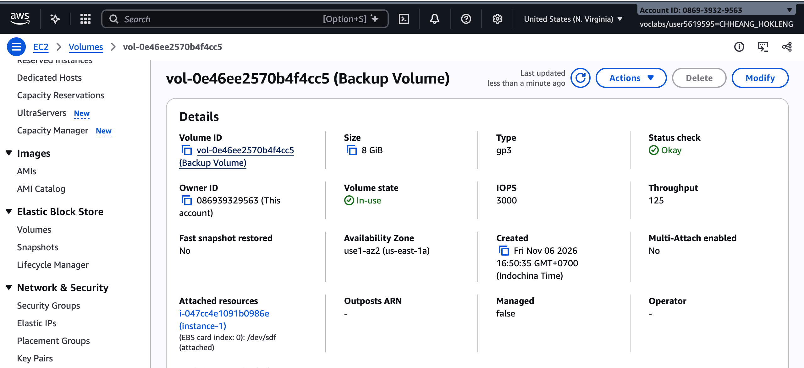
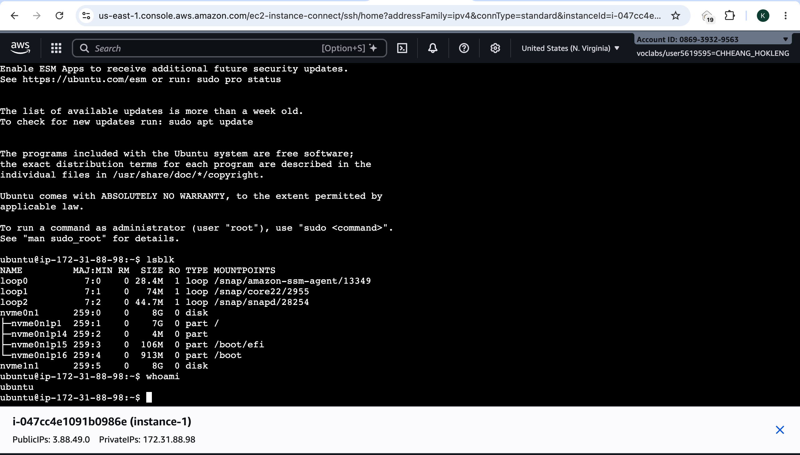
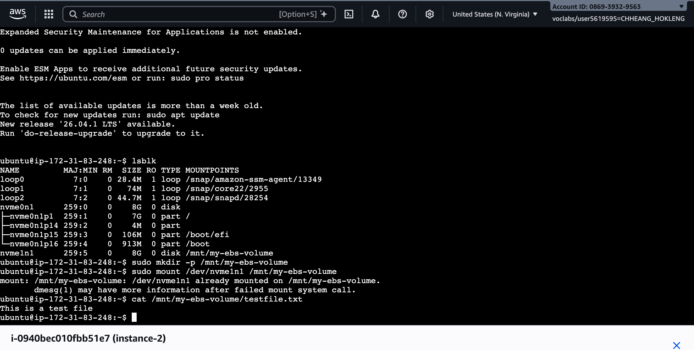
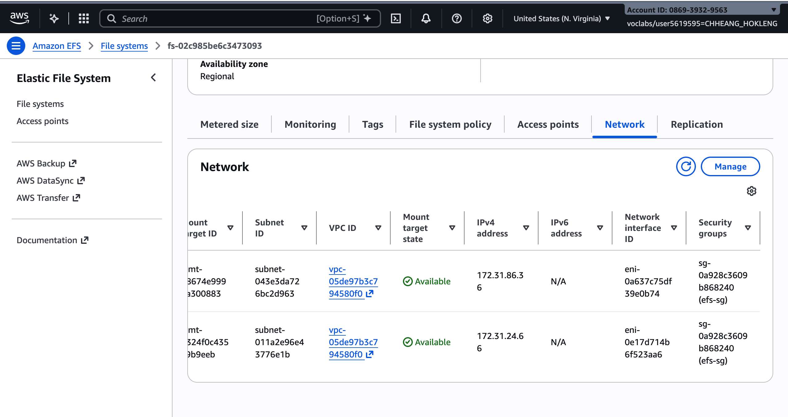
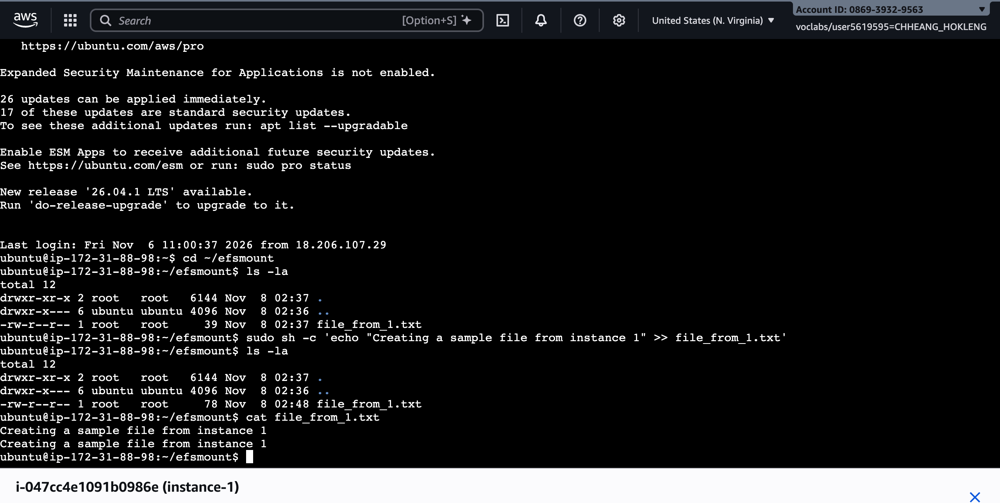
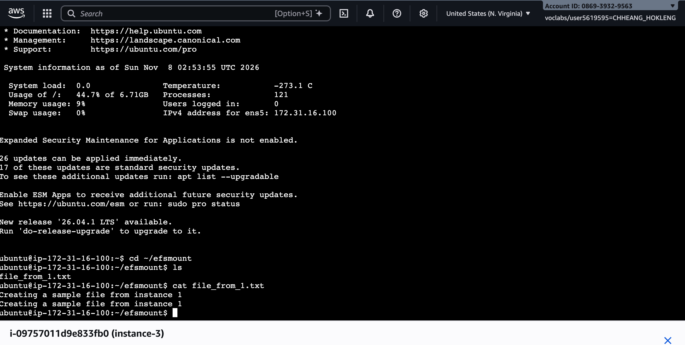

# Lab 3 — AWS Storage (S3, EBS, EFS)

**Course:** ITC-I5GIC-CC (Cloud Computing)  
**Region:** `us-east-1` (US East N. Virginia)

- **Student name:** CHHEANG HOKLENG  
- **Student ID:** e20220695  
- **Learner Lab user name:** CHHEANG_HOKLENG  
- **Date completed:** 2026-11-08

## What this lab demonstrates

You used **Amazon S3** for objects and a static website, **Amazon EBS** as a block volume moved between two EC2 instances, and **Amazon EFS** as a shared file system between instances in different subnets. On **t3** instances, extra EBS volumes often appear as **`/dev/nvme1n1`** instead of `/dev/xvdf`.

---

## Screenshots

### Part 2.1 — Amazon S3

#### `01-s3-bucket-list.png`

S3 bucket list showing **`static-web-bucket-...`** in **`us-east-1`** (Learner Lab user visible top-right).

#### `02-s3-objects.png`

Objects **`index.html`** and **`error.html`** at bucket root.

#### `03-s3-website.png`

Browser on the **static website endpoint** (`http://....s3-website-us-east-1.amazonaws.com/`).

---

### Part 2.2 — Amazon EBS

#### `04-ebs-volumes.png`

EC2 → **Volumes**: **Backup Volume** state **In-use**.

#### `05-ebs-lsblk.png`

**EC2 Instance Connect** on **`instance-1`** with **`lsblk`** showing root volume and attached **8 GiB** volume (e.g. **`nvme1n1`**).

**Device name used for Backup Volume on this instance:** `/dev/nvme1n1`

#### `06-ebs-second-instance.png`

**EC2 Instance Connect** on **`instance-2`**: **`cat testfile.txt`** after mounting the same volume (no second `mkfs`).

---

### Part 2.3 — Amazon EFS

#### `07-efs-file-system.png`

EFS console: **`clab-efs`**, Regional, **Enhanced / Elastic**, mount targets in **us-east-1a** and **us-east-1b** with **`efs-sg`**.

**File system ID:** `fs-02c985be6c3473093`

#### `08-efs-write.png`

**instance-1**: **`~/efsmount`** — creating **`file_from_1.txt`**.

#### `09-efs-read.png`

**instance-3**: **`ls`** / **`cat file_from_1.txt`** in **`~/efsmount`**.

---

## Questions (from the course template)

1. After you turned on static website hosting, the endpoint first answered **403 Forbidden**. Why, and what changed after you added the bucket policy?
   - Static hosting only provides a URL; objects were still private. **Block Public Access** was off, but there was no policy allowing `s3:GetObject` for the public. The bucket policy added `Allow` for `Principal: *` on `arn:.../*`, so browsers could read the website files.

2. **`testfile.txt`** was still there after you moved **Backup Volume** to **`instance-2`**. What would have happened to a file saved on **`instance-1`**'s **root** volume after terminating **`instance-1`**?
   - Data on the **root** volume is deleted with the instance (default delete-on-terminate). **Backup Volume** is a separate EBS volume, so it persists until you delete it.

3. Why did you run **`mkfs`** on **`instance-1`** but not on **`instance-2`**?
   - First attach: the volume had no file system, so `mkfs` was required. On **instance-2** the file system already existed; `mkfs` would wipe **testfile.txt**.

4. Why could **`instance-1`** and **`instance-3`** use the EFS file system at the same time, when an EBS volume had to be detached first? Why did they have to be in the subnets of the mount targets?
   - **EFS** is a shared NFS service with mount targets per AZ; many instances can mount concurrently. **EBS** attaches to one instance at a time in one AZ. Instances reach EFS via the mount target IP in their subnet/AZ.

5. For each need, choose **S3**, **EBS** or **EFS** and give one reason: (a) a website's images, (b) the disk of a database server, (c) a folder shared by several web servers.
   - (a) **S3** — object storage over HTTP, scalable, good for static assets. (b) **EBS** — block storage for one instance, low latency like a local disk. (c) **EFS** — shared POSIX file system across instances.

---

## Problems and how I solved them (optional)

- EBS device was **`nvme1n1`** on **t3** — used **`lsblk`** instead of **`/dev/xvdf`**. **`efs-utils` build failed** on Ubuntu 24.04 (Rust lockfile); mounted EFS with **`nfs-common`** and **`mount -t nfs4`** to the same `efsmount` path; shared file worked across **instance-1** and **instance-3**.

---

## Conclusion

This lab is **complete**. In **`us-east-1`**, I built and used three AWS storage types for different jobs:

- **S3** stored website objects and served a **static site** after hosting and a **public read** bucket policy.
- **EBS** gave **instance-1** an extra 8 GiB disk; data on **Backup Volume** survived a **detach/reattach** to **instance-2** without running **`mkfs`** again.
- **EFS** (**`clab-efs`**) let **instance-1** (us-east-1a) and **instance-3** (us-east-1b) share **`file_from_1.txt`** at the same time through mount targets in each AZ.

I can now tell **S3**, **EBS**, and **EFS** apart: objects and static content → S3; one instance’s block disk → EBS; many instances sharing files → EFS. Screenshots in `images/` document each part; resources were removed after capture per the clean-up checklist below.

---

## Clean up

- [ ] Instances **`instance-1`**, **`instance-2`**, **`instance-3`** terminated.
- [ ] **`clab-efs`** deleted.
- [ ] **Backup Volume** deleted.
- [ ] Security groups **`efs-sg`** and **`ec2instances-sg`** deleted.
- [ ] S3 **`static-web-bucket-...`** emptied (all versions) and bucket deleted.
