# Cloud Lab 4 Submission — Amazon VPC

**Course:** ITC-I5GIC-CC (Cloud Computing)  
**Region:** `us-east-1` (US East N. Virginia)

- **Student name:** CHHEANG HOKLENG  
- **Student ID:** e20220695  
- **Learner Lab user name:** CHHEANG_HOKLENG  
- **Date completed:** 2026-11-08

## What this lab demonstrates

You built **lab4-vpc** with a **public** and **private** subnet, routed public traffic through an **internet gateway**, gave the private subnet outbound internet via a **NAT gateway**, and verified connectivity with **Systems Manager Run Command** on **lab4-ec2-01** and **lab4-ec2-02**.

---

## Screenshots

## VPC and internet gateway

#### `01-vpc.png`

VPC **lab4-vpc**, IPv4 CIDR **10.0.0.0/24**.

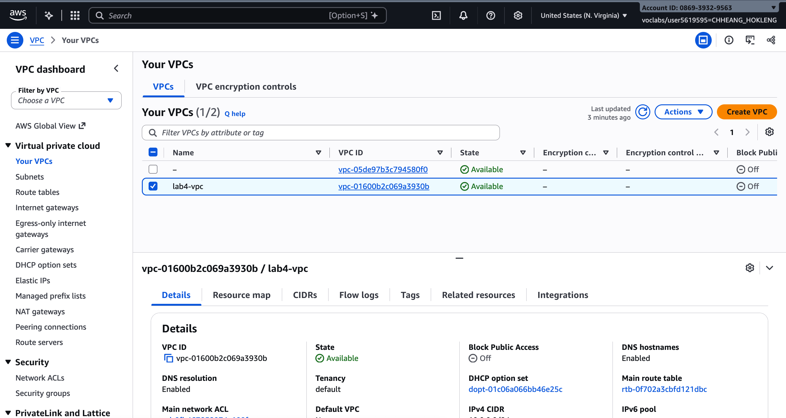

#### `02-internet-gateway.png`

**lab4-internet-gateway** attached to **lab4-vpc**.

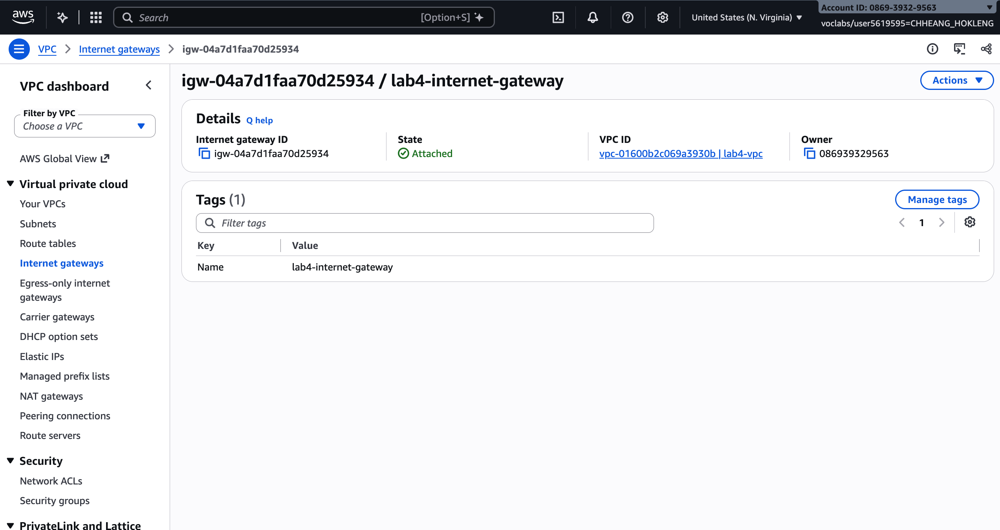

## Public subnet

#### `03-public-subnet.png`

**lab4-public-subnet**, CIDR **10.0.0.0/25**, AZ **us-east-1a**.

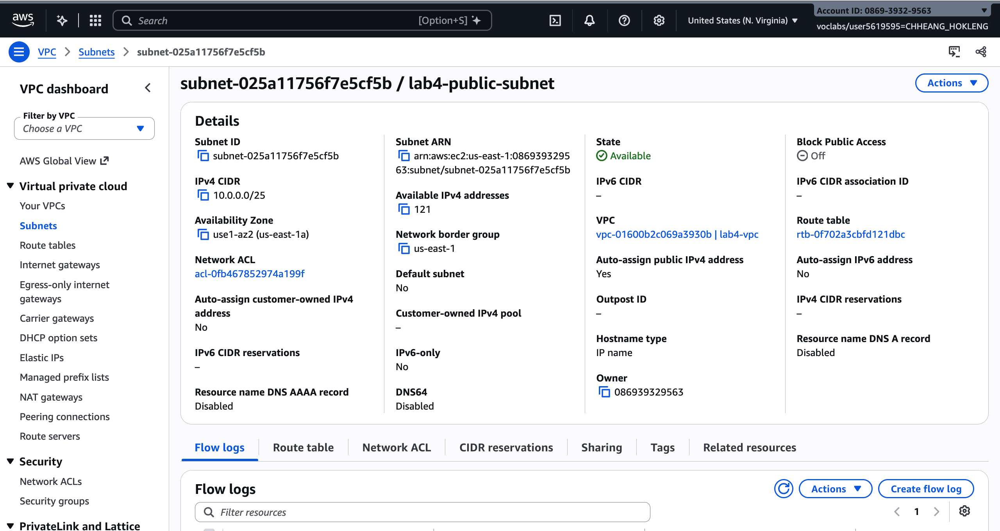

#### `04-public-route-table.png`

Public subnet routing through the internet gateway (main route table for **lab4-vpc**).

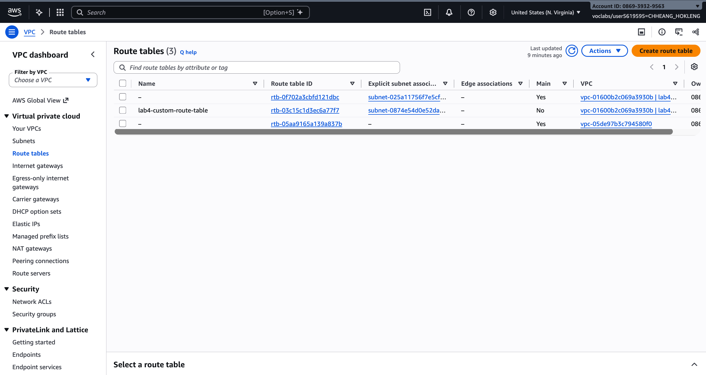

#### `05-ec2-public.png`

**lab4-ec2-01** *Running* in **lab4-public-subnet** with a public IPv4 address.

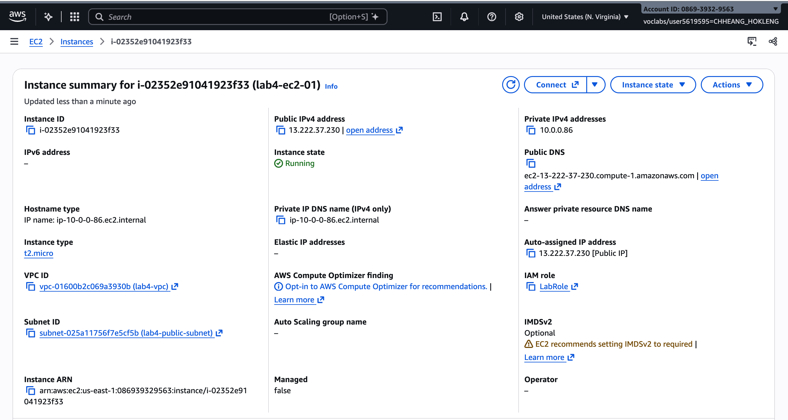

#### `06-test-public.png`

Systems Manager Run Command **Success** for `sudo yum update -y` on **lab4-ec2-01**.

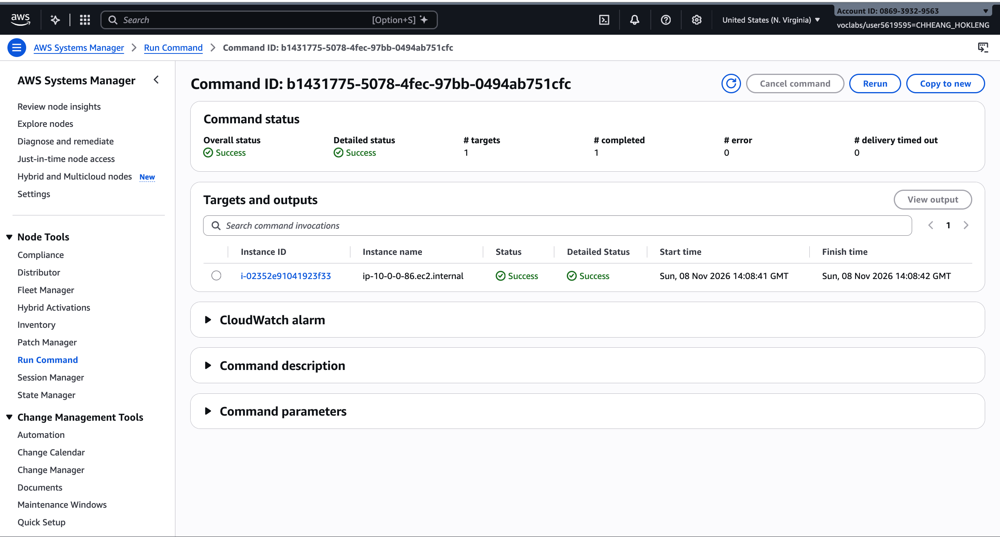

## Private subnet

#### `07-private-subnet.png`

**lab4-private-subnet**, CIDR **10.0.0.128/25**.

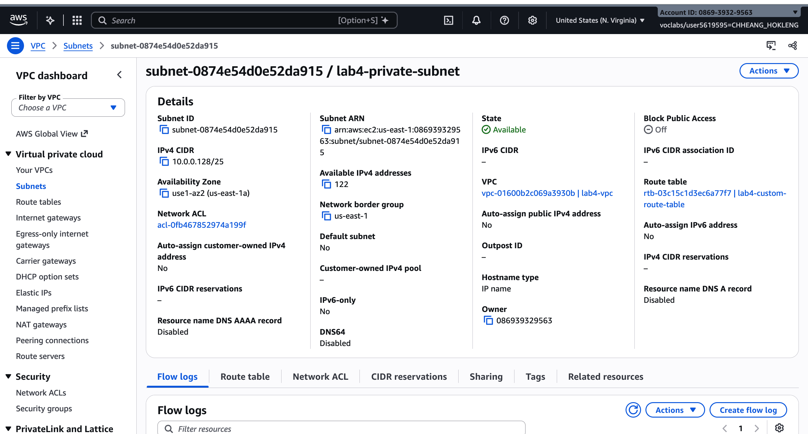

#### `08-nat-gateway.png`

**lab4-nat-gateway** *Available* in **lab4-public-subnet** with an Elastic IP.

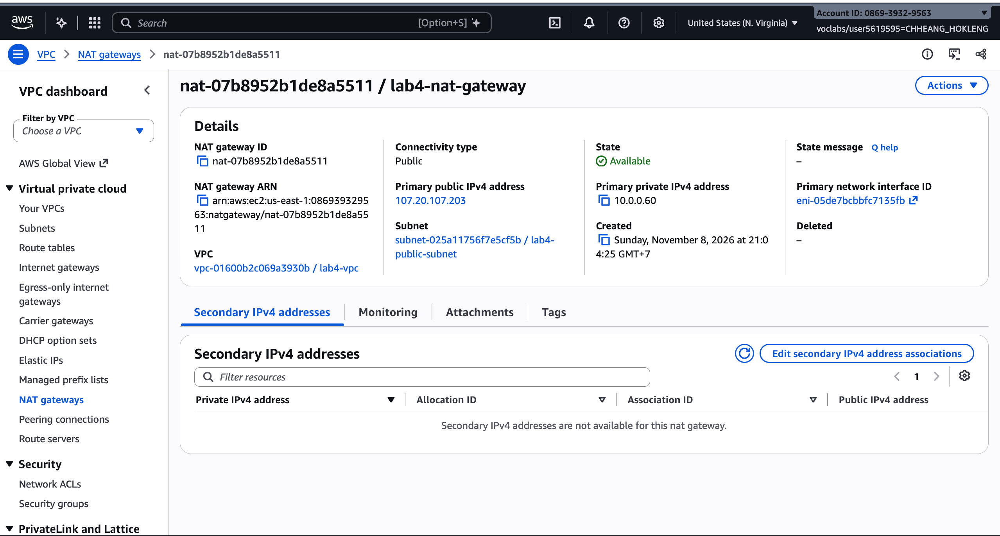

#### `09-private-route-table.png`

**lab4-custom-route-table**: **0.0.0.0/0** → **lab4-nat-gateway**, associated with the private subnet.

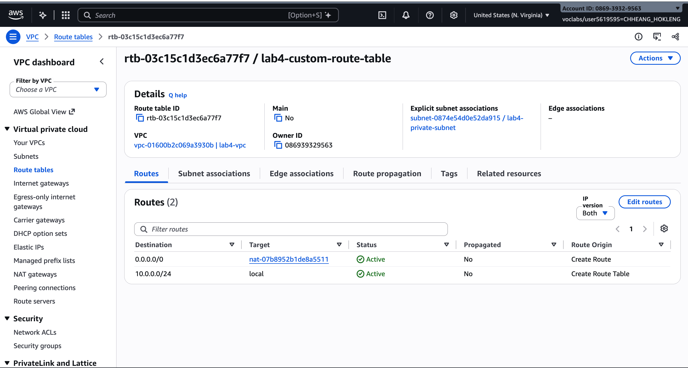

#### `10-ec2-private.png`

**lab4-ec2-02** *Running* in **lab4-private-subnet**, no public IPv4 address.

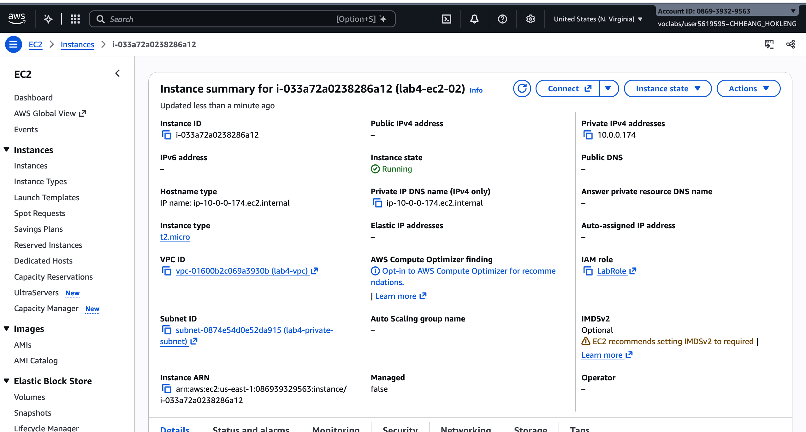

#### `11-test-private.png`

Run Command **Success** for `sudo yum update -y` on **lab4-ec2-02**.

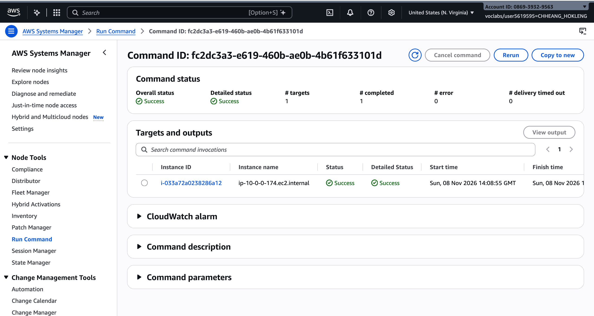

---

## Questions

1. A **`/24`** block has 256 IPv4 addresses (AWS reserves a few per subnet). A **`/25`** block has **128** addresses. **`10.0.0.0/25`** uses `10.0.0.0`–`10.0.0.127`; **`10.0.0.128/25`** uses `10.0.0.128`–`10.0.0.255`. They do not overlap because the split is at `.128` in the fourth octet.
2. **`lab4-public-subnet`** is *public* because its route table sends **`0.0.0.0/0`** to the **internet gateway**, and instances can get a **public IP** so outbound (and return) internet traffic can flow through the IGW. **`lab4-private-subnet`** has no default route to the IGW (only `local` for the VPC and **`0.0.0.0/0` → NAT gateway**), and **`lab4-ec2-02`** was launched **without** a public IP, so it is not directly internet-reachable.
3. A **NAT gateway** must sit in a subnet that already has a path to the internet (via an **internet gateway**). The **public** subnet has that path. Private instances send outbound traffic to the NAT; the NAT translates and forwards through the IGW. Placing NAT in the private subnet would not work, because that subnet has no IGW route.
4. **`lab4-ec2-02`** has **no public IP**, so arbitrary hosts on the internet **cannot** initiate connections to it (nothing routes inbound to that private address). It **can** download updates because outbound traffic to the internet goes **`0.0.0.0/0` → NAT gateway → IGW**; replies are allowed back through the NAT’s connection tracking.
5. **Systems Manager Run Command** uses the SSM agent on the instance and the **SSM service** in AWS. The **`LabInstanceProfile`** attaches **`LabRole`**, which grants permissions (for example to register with SSM, receive commands, and report status) so AWS can manage the instance **without SSH** or inbound security group rules.

## Problems and how I solved them (optional)

- Run Command on the private instance took a few minutes to show **Success**; refreshed the command status page until it completed.
- Two VPCs appear in the account (default **172.31.0.0/16** and **lab4-vpc**); only **lab4-vpc** is used for this lab.

## Clean up

- [x] Instances terminated.
- [x] NAT gateway deleted and its Elastic IP released.
- [x] Internet gateway detached and deleted.
- [x] `lab4-vpc` deleted.
