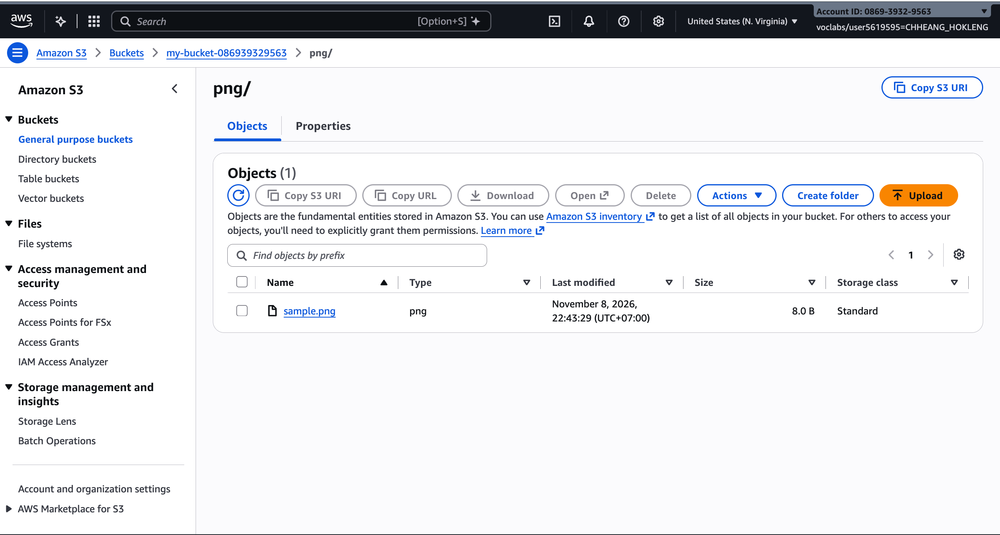
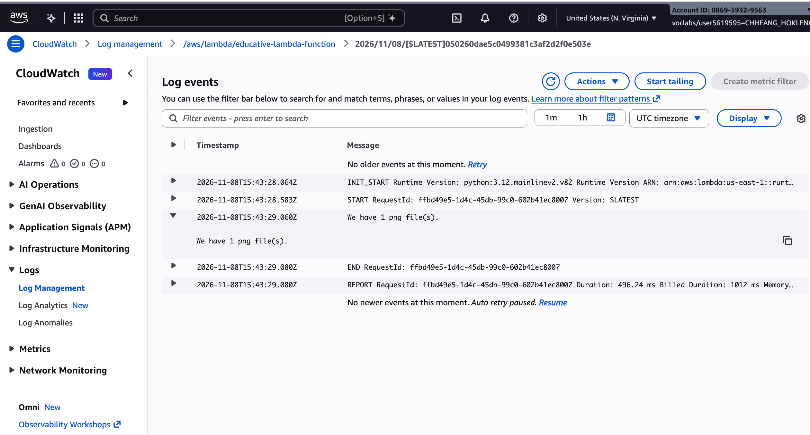

# Cloud Lab 5 Submission — S3 Events with AWS Lambda

**Course:** ITC-I5GIC-CC (Cloud Computing)  
**Region:** `us-east-1` (US East N. Virginia)

- **Student name:** CHHEANG HOKLENG  
- **Student ID:** e20220695  
- **Learner Lab user name:** CHHEANG_HOKLENG  
- **Bucket name:** `my-bucket-086939329563`  
- **Date completed:** 2026-11-08

---

## Files sorted by type

Which files did you upload, and which folders did the function create?

I uploaded **`sample.png`** to the bucket root. The Lambda function created the **`png/`** prefix and moved the object to **`png/sample.png`**.

## CloudWatch logs

After the upload, the log stream for **`educative-lambda-function`** showed **`We have 1 png file(s).`** with a timestamp (see screenshot).

## Function code

My function code is in [lambda_function.py](lambda_function.py).

---

## Questions

1. When I click **Upload** in **Amazon S3**, the object is stored with a **PUT**. **S3** sends an **ObjectCreated:Put** notification to **AWS Lambda**, which runs **`educative-lambda-function`**. The function (using **LabRole** via **IAM**) calls **S3** to **copy** the file into a folder named after its extension, **delete** the original key, list objects, and **print** counts. **Lambda** sends that print output to **Amazon CloudWatch Logs**, where it appears as a log event.
2. The trigger is limited to **PUT** because the function itself writes to the same bucket with **copy_object**, which is a *Copy* event, not a PUT. If the trigger were **All object create events**, each copy would invoke Lambda again. With this code, that causes recursive invocations, failures, and retries; with other code it could loop endlessly. **PUT** only fires on the original upload from the console.
3. **`LabRole`** must allow **S3** actions on the bucket (for example **GetObject**, **PutObject**, **DeleteObject**, **ListBucket**) so the function can move and count files. It also needs **CloudWatch Logs** permissions (for example **CreateLogGroup**, **CreateLogStream**, **PutLogEvents**) so `print` output is stored in logs.
4. **AWS Lambda** runs the Python code on AWS-managed servers. I did not start or stop an EC2 instance. I pay for **Lambda** invocations and **duration** (GB-seconds), plus small charges for related **S3** requests and **CloudWatch Logs** storage, only when the function runs.

## Problems and how I solved them (optional)

- Log streams can take a few seconds after upload; I refreshed **Log streams** and opened the newest entry before taking the screenshot.

## Clean up

- [ ] Lambda function deleted.
- [ ] S3 bucket emptied and deleted.
