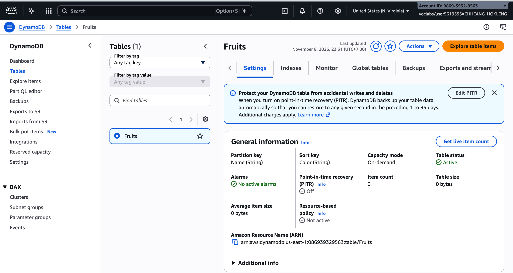
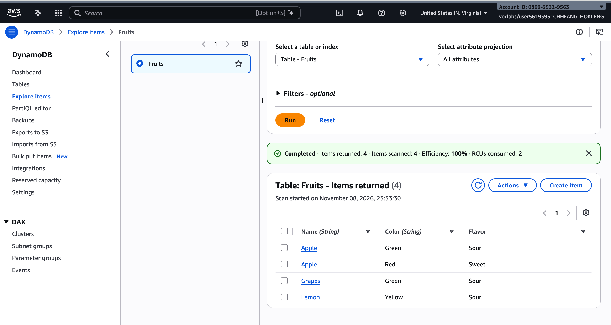
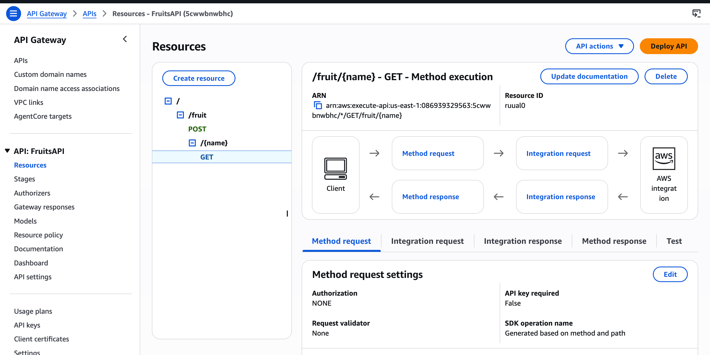
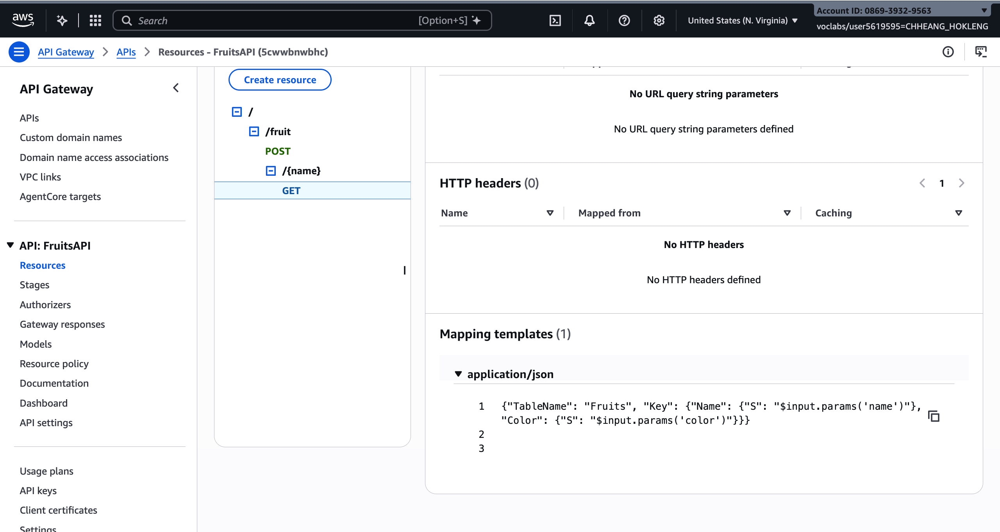
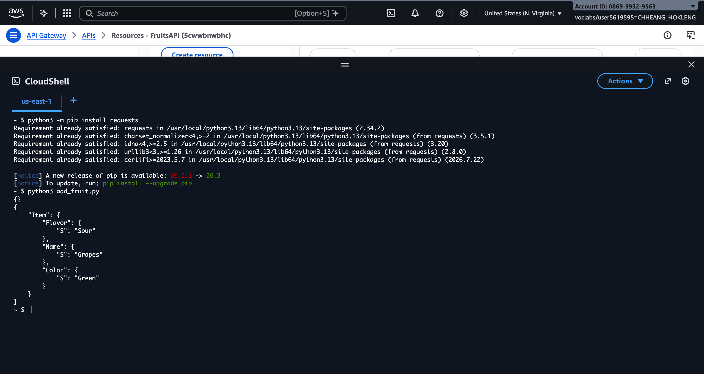
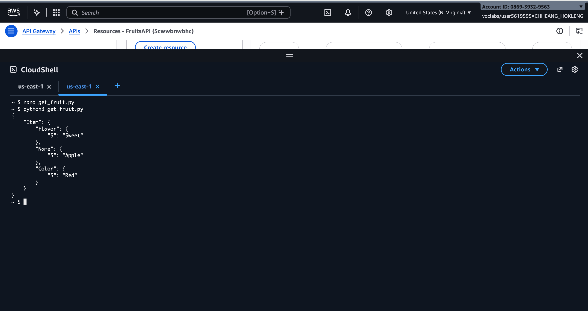
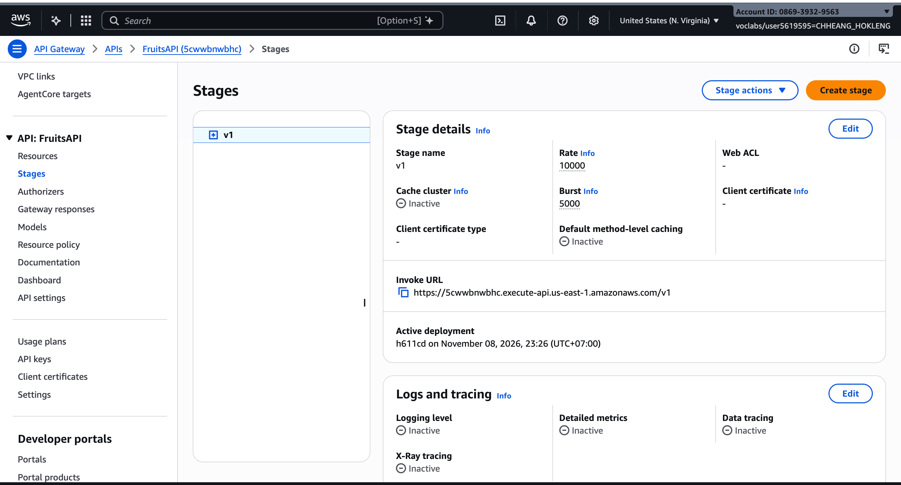

# Cloud Lab 6 Submission — API Gateway and DynamoDB

**Course:** ITC-I5GIC-CC (Cloud Computing)  
**Region:** `us-east-1` (US East N. Virginia)

- **Student name:** CHHEANG HOKLENG  
- **Student ID:** e20220695  
- **Learner Lab user name:** CHHEANG_HOKLENG  
- **Date completed:** 2026-11-08

---

## 1. DynamoDB table

## 2. Table items

## 3. REST API resources

## 4. GET mapping template

## 5. POST /fruit

## 6. GET /fruit/{name}

## 7. Stage and Invoke URL

## Scripts

- [populate_table.py](populate_table.py)
- [get_fruit.py](get_fruit.py)
- [add_fruit.py](add_fruit.py)

**Invoke URL used in scripts:** `https://5cwwbnwbhc.execute-api.us-east-1.amazonaws.com/v1` (replace in CloudShell if you redeploy.)

---

## Questions

1. The primary key is **composite**: partition key **`Name`** and sort key **`Color`**. Two items can share the same `Name` when **`Color`** differs, so `Apple / Red` and `Apple / Green` are distinct items.
2. **API Gateway’s AWS service integration** for DynamoDB calls the **DynamoDB control plane API**, which uses **HTTP POST** for actions such as **`GetItem`**, even though the client called **HTTP GET** on the REST API. The REST method is GET; the integration forwards a POST to DynamoDB with the mapped JSON body.
3. A **mapping template** converts the incoming API request into the JSON shape DynamoDB expects. On **GET**, the template sets **`TableName`** to `Fruits` and **`Key.Name.S`** from **`$input.params('name')`** (path) and **`Key.Color.S`** from **`$input.params('color')`** (query string).
4. Without **`color`**, the required query parameter is missing. API Gateway returns a **4xx** client error (for example **400 Bad Request**) and DynamoDB **`GetItem`** is not called with a complete key.
5. **Advantage:** no servers or Lambda to manage; simple CRUD-style integration. **Limit:** limited transformation logic, harder debugging, and tight coupling to DynamoDB compared with Lambda or a full application backend.

## Problems and how I solved them (optional)

- Ran **`populate_table.py`** in **CloudShell** (boto3 available there). Test scripts need **`pip3 install --user requests`** in CloudShell if needed.

## Clean up

- [ ] `FruitsAPI` deleted.
- [ ] `Fruits` table deleted.
