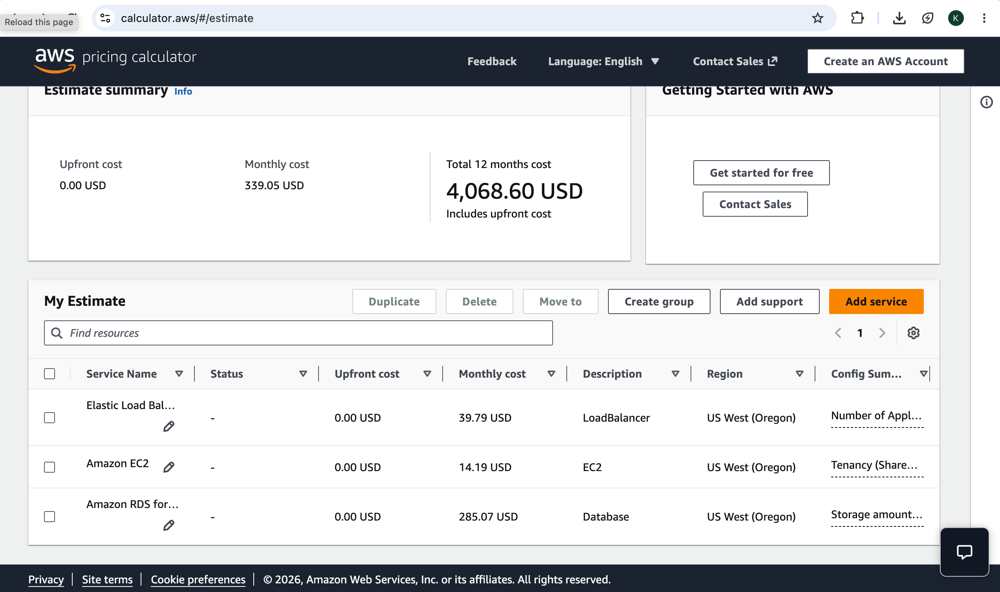
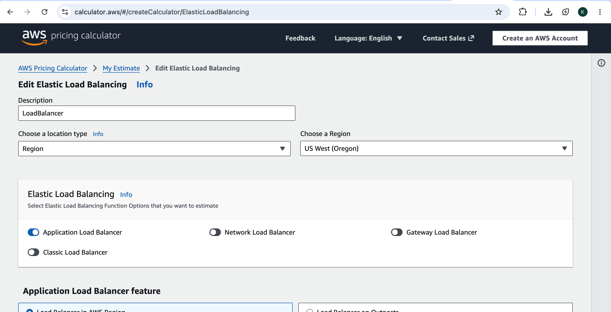
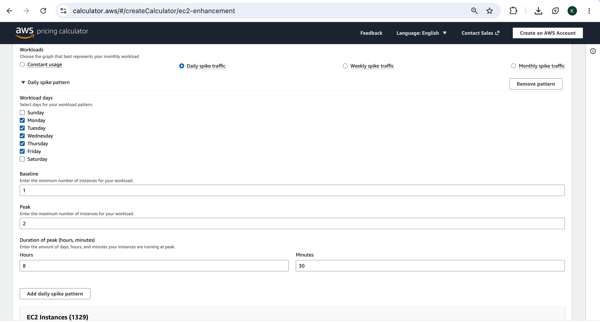
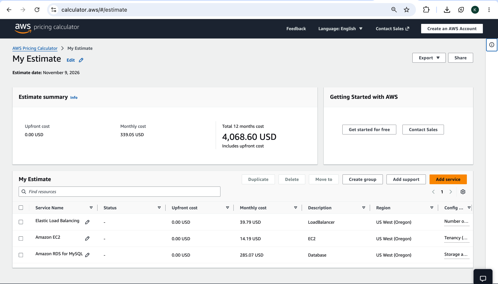
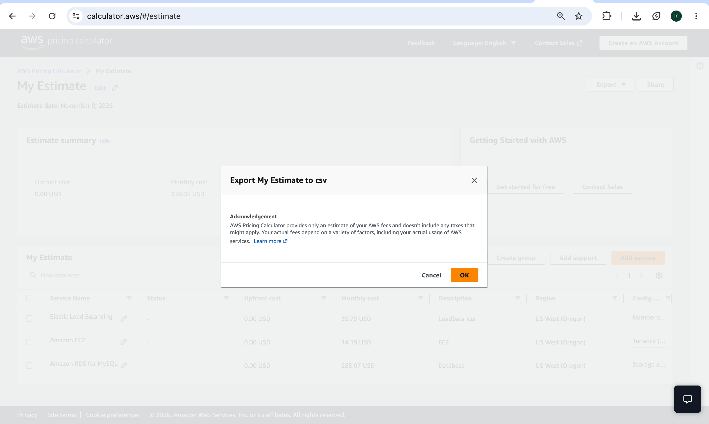
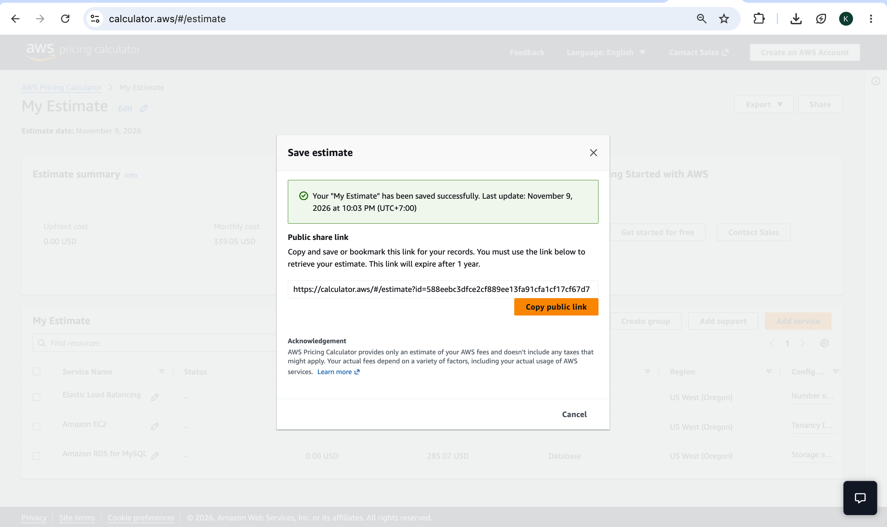

# Cloud Lab 8 Submission — Cost Estimation

- **Student name:** CHHEANG HOKLENG
- **Student ID:** e20220695
- **Date completed:** 2026-11-09
- **Public estimate link:** https://calculator.aws/#/estimate?id=588eebc3dfce2cf889ee13fa91cfa1cf17cf67d7
- **CSV export:** [estimate.csv](estimate.csv)

---

## 1. Services added

My Estimate lists Elastic Load Balancing, Amazon EC2, and Amazon RDS for MySQL in US West (Oregon).

## 2. Load balancer configuration

Application Load Balancer in US West (Oregon) with LCU inputs for EC2 target traffic (connections, duration, requests, and rules).

## 3. EC2 configuration

Linux EC2 with Daily spike traffic (baseline 1, peak 2 on weekdays), On-Demand pricing, and gp3 storage.

## 4. Cost summary

Estimate summary showing monthly and 12-month totals for ALB, EC2, and RDS (about $339.05 per month).

| Service | Monthly cost (USD) | 12-month cost (USD) |
|---|---:|---:|
| Elastic Load Balancing | 39.79 | 477.48 |
| Amazon EC2 | 14.19 | 170.31 |
| Amazon RDS for MySQL | 285.07 | 3420.84 |
| **Total** | 339.05 | 4068.60 |

## 5. CSV export

Export to CSV confirmation before downloading estimate.csv with per-service cost lines.

## 6. Shared link

Share dialog after saving the estimate, showing the public calculator.aws link for this estimate.

---

## Questions

1. Which service costs the most in your estimate? Give one reason from its configuration.

   **Answer:** Amazon RDS for MySQL is usually the highest cost. This estimate uses **db.m6g.large** with **Multi-AZ** in **US West (Oregon)** and **100 GB** gp2 storage, so you pay for a primary and standby instance plus provisioned storage.

2. Change the RDS deployment from **Multi-AZ** to **Single-AZ** (do not save it in your shared estimate). How does the RDS cost change, and what do you lose by choosing Single-AZ?

   **Answer:** Single-AZ typically lowers RDS instance charges by roughly half compared with Multi-AZ (one instance instead of primary plus standby). You lose synchronous replication and automatic failover to another Availability Zone, so recovery from an AZ failure can take longer and need manual intervention.

3. The EC2 workload uses **Daily spike traffic** (1 instance, 2 at peak). Why is this cheaper than running 2 instances all the time?

   **Answer:** With **Daily spike traffic**, billing reflects **one** instance outside peak and **two** only during the configured weekday peak window. Two instances running 24×7 would accrue roughly twice as many instance-hours over a month.

4. Why is it useful to estimate the cost of an architecture **before** deploying it?

   **Answer:** You see upfront and monthly/12-month spend before provisioning, can compare options (for example Single-AZ vs Multi-AZ or instance size), set budgets, and avoid unexpected bills after go-live.
