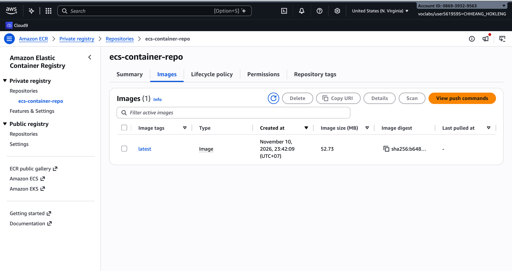
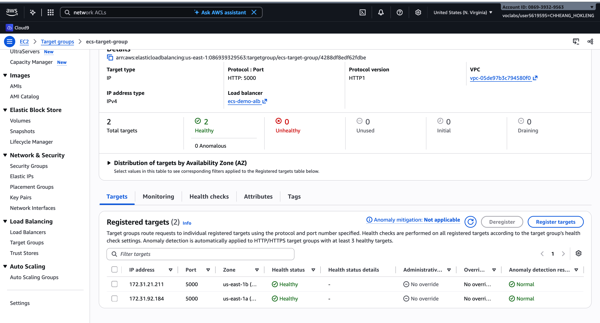
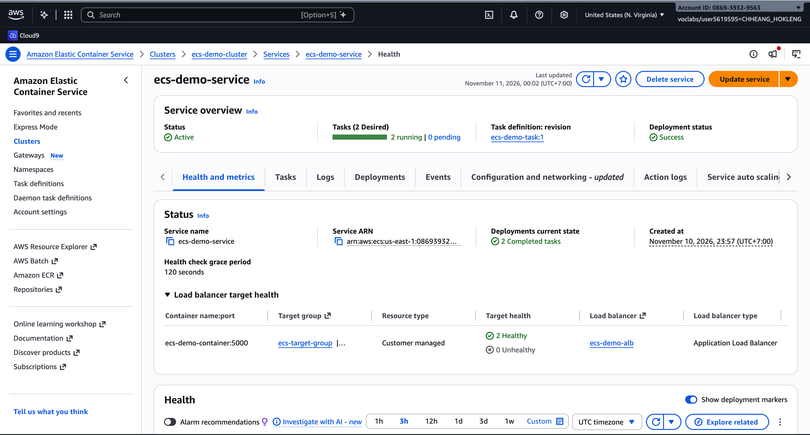
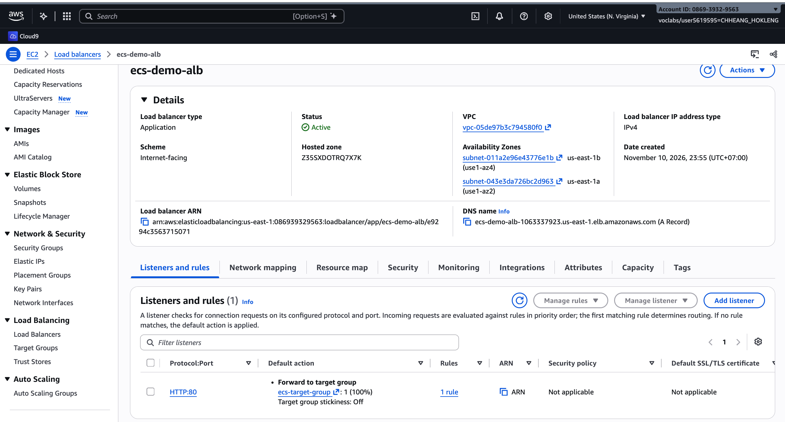
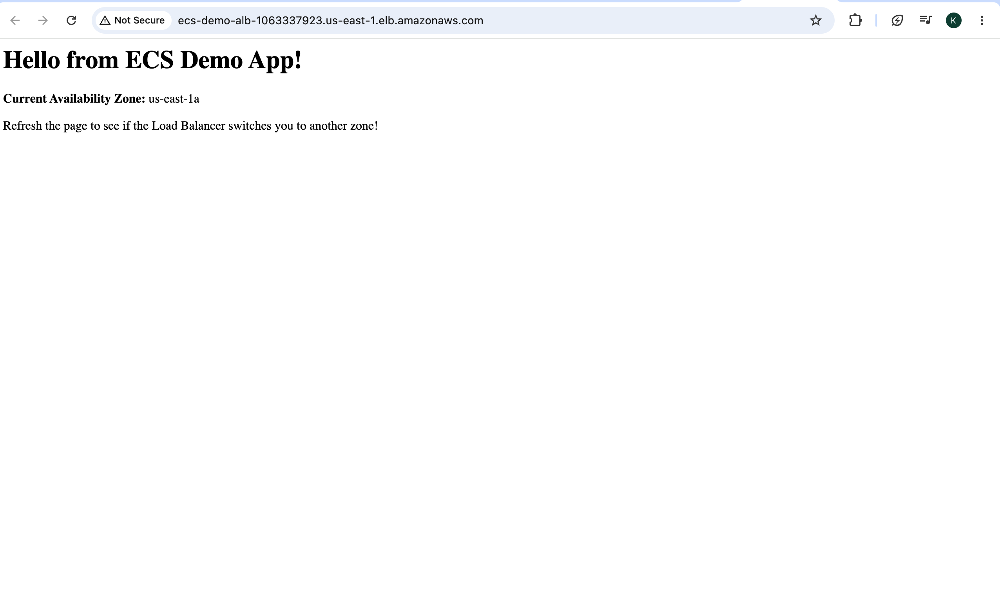
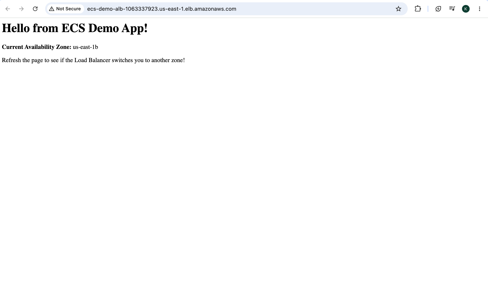

# Cloud Lab 9 Submission — Amazon ECS

- **Student name:** CHHEANG HOKLENG
- **Student ID:** e20220695
- **Learner Lab user name:** voclabs/user5619595=CHHEANG_HOKLENG
- **Build environment used:** EC2 instance (`ecs-demo-build`, Amazon Linux 2023)
- **Date completed:** November 10–11, 2026

---

## 1. Image in ECR

The Flask app image was built on the EC2 build instance and pushed to the private repository `ecs-container-repo` with tag `latest` in `us-east-1`.

## 2. Target group health

The Application Load Balancer target group `ecs-target-group` registers two task IP addresses on port 5000; both targets report **Healthy** after HTTP health checks on path `/`.

## 3. ECS service

Fargate service `ecs-demo-service` on cluster `ecs-demo-cluster` maintains **2 desired** and **2 running** tasks using task definition `ecs-demo-task`, with deployment status **Success**.

## 4. Load balancer

Internet-facing Application Load Balancer `ecs-demo-alb` listens on **HTTP port 80** and forwards traffic to `ecs-target-group`; the DNS name is used to open the app in a browser.

## 5. Application — Availability Zone us-east-1a

Opening the ALB URL shows the demo page; this request was served by a task running in **us-east-1a**, as reported by ECS task metadata in the Flask app.

## 6. Application — Availability Zone us-east-1b

Refreshing the same ALB URL routed the request to a task in **us-east-1b**, showing that the load balancer distributes traffic across tasks in different subnets/AZs.

## Application files

- [app/app.py](app/app.py)
- [app/Dockerfile](app/Dockerfile)

---

## Questions

### 1. Put these in the order they happen and say what each does: `docker push`, `docker build`, `docker login`, `docker tag`.

1. **`docker login`** — Authenticate the Docker client to Amazon ECR using a short-lived password from the AWS CLI.
2. **`docker build`** — Build a local image from the `Dockerfile` and application files in the build context.
3. **`docker tag`** — Assign the ECR registry URI and repository name (e.g. `…/ecs-container-repo:latest`) to the local image so ECR accepts the push.
4. **`docker push`** — Upload the tagged image layers to the ECR repository.

### 2. What is the difference between the ECR **repository**, the ECS **task definition**, a **task** and the ECS **service**?

- **ECR repository** — Stores versioned container **images** (artifacts).
- **Task definition** — Blueprint for a task: image URI, CPU/memory, ports, roles, and container settings.
- **Task** — One **running** (or stopped) instance of a task definition (e.g. one Fargate container).
- **Service** — Keeps the **desired number** of tasks running, rolls out new task definition revisions, and registers task IPs with the load balancer target group.

### 3. `ecs-task-sg` allows port 5000 only from `alb-sg`. What would happen if you opened `http://<task-public-IP>:5000` directly in your browser? Why is this rule safer than allowing port 5000 from anywhere?

With ingress limited to `alb-sg`, traffic from the public internet to the task’s public IP on port 5000 is **not** allowed by the security group, so the browser connection would **fail** (timeout or connection refused). Only the load balancer (in `alb-sg`) can reach the app on 5000. This is safer because the application is not exposed directly on the internet; users reach it only through the ALB on port 80, which provides a single controlled entry point.

### 4. Why must the target group use the target type **IP addresses** for Fargate tasks?

Fargate tasks use `awsvpc` networking: each task gets its own elastic network interface and **private IP**, not a stable EC2 instance ID. The Application Load Balancer must register those **task IP addresses** as targets. Instance-type target groups are for EC2-backed ECS or classic EC2, not Fargate awsvpc tasks.

### 5. Stop one of the two tasks in the console (optional). What does the service do, and why?

The service compares **running count** to **desired count** (2). When a task stops, it is **below desired**, so ECS **starts a replacement task** (often in another AZ) to restore two running tasks. This supports **high availability** and matches the load balancer’s expectation of healthy targets behind `ecs-demo-alb`.

## Problems and how I solved them (optional)

- **InvalidClientTokenId on EC2** — Learner Lab session token was expired or split across multiple lines when pasting. Fixed by exporting all three variables on one line and refreshing credentials from **AWS Details**.
- **ECS service linked role** — First `create-service` failed until the ECS service-linked role was available; retry succeeded.

## Clean up

- [ ] ECS service and cluster deleted.
- [ ] Load balancer and target group deleted.
- [ ] EC2 build instance (`ecs-demo-build`) terminated.
- [ ] ECR repository deleted (if required by instructor).
- [ ] Security groups `ecs-task-sg` and `alb-sg` deleted.
